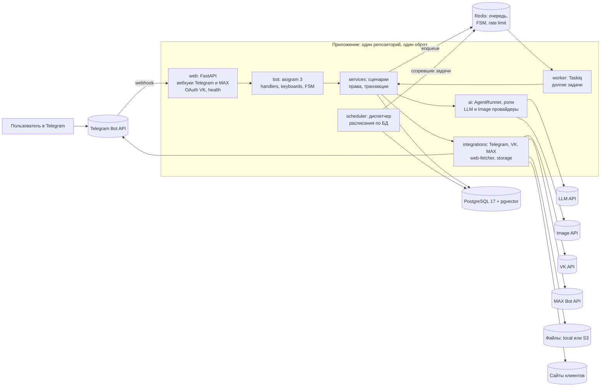
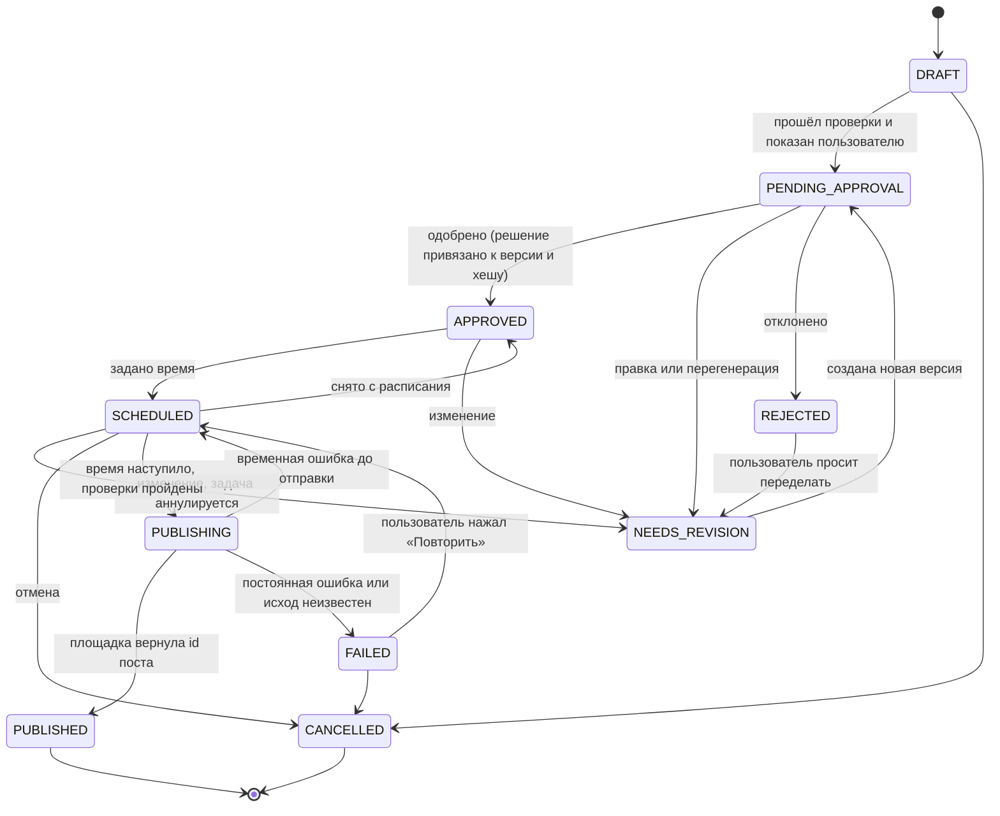
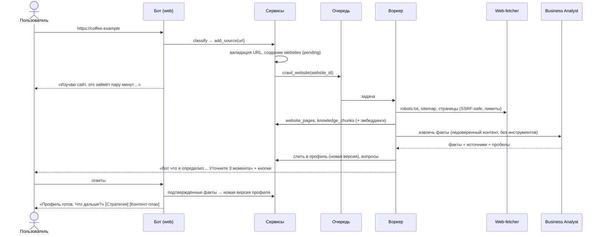
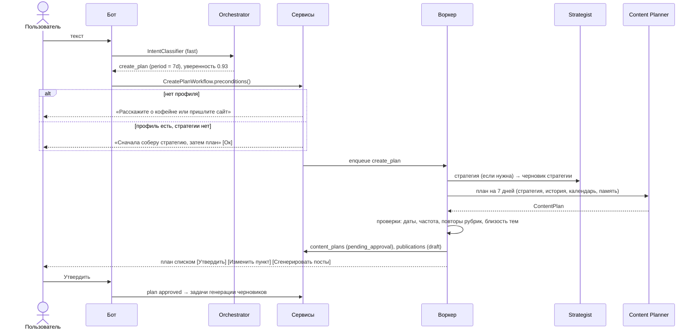
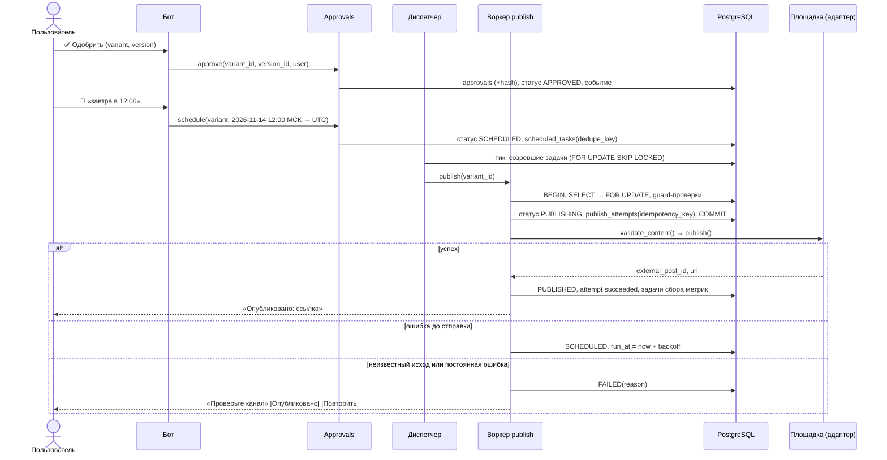
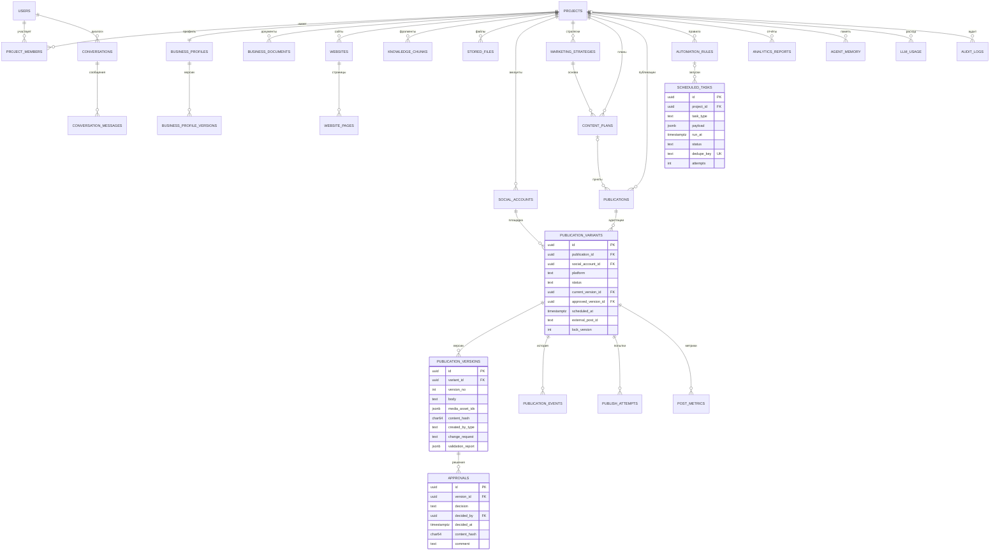

# Автономный AI-маркетолог — технический анализ и архитектура (Этап 1)

| | |
|---|---|
| Статус | **Ответы заказчика получены** — формат проекта: демонстрация на хакатоне. Актуальные решения — в §0.1 |
| Дата | 13.11.2026 (v0.1), 14.11.2026 (v0.2) |
| Версия | 0.2 |
| Репозиторий | пустой (git ещё не инициализирован — сделаем на Этапе 2) |

> Факты о внешних API проверены 13.11.2026 по официальной документации там, где она была доступна, и помечены уровнем достоверности. Всё, что взято из сторонних источников или требует живой проверки, помечено **[проверить в спайке]**. Список источников — в §15.

---

## 0. Резюме для принятия решений

1. **Архитектура — модульный монолит**, а не микросервисы: один репозиторий на Python 3.13, три типа процессов: `web` (FastAPI + вебхуки Telegram/MAX + OAuth VK), `worker` (фоновые задачи), `scheduler` (диспетчер расписания). Хранилища: PostgreSQL 17 + pgvector, Redis. Этого достаточно до сотен активных проектов, а модули изолированы так, что их можно вынести в сервисы позже.
2. **«Агенты» — это роли, а не отдельные автономные LLM-процессы.** Один `AgentRunner` плюс набор ролей: у каждой свой промпт, своя Pydantic-схема ответа, свой набор допустимых данных и инструментов. Оркестратор = классификатор намерений (дешёвая модель) + **детерминированные сценарии (workflow) в коде**. У LLM **нет инструмента «опубликовать»** — публикация возможна только через Approval Workflow.
3. **Публикация защищена четырьмя независимыми уровнями:** (1) конечный автомат статусов; (2) согласование привязано к конкретной версии и её хешу; (3) проверка статуса в транзакции с блокировкой строки непосредственно перед отправкой; (4) ключ идемпотентности и частичный уникальный индекс «не более одной успешной публикации на вариант». Для VK дополнительно используется штатный параметр `guid` у `wall.post`.
4. **Планировщик опирается на PostgreSQL, а не на брокер очередей.** Раз в 30 секунд диспетчер забирает созревшие задачи (`FOR UPDATE SKIP LOCKED`) и ставит их в очередь. После рестарта всё восстанавливается само; отмена — это изменение строки в БД. Очередь — **Taskiq + Redis** (асинхронный аналог Celery, обоснование в §8). При желании Celery подключается без изменения бизнес-логики.
5. **Реальная доступность площадок:**
   - **Telegram** — публикация реализуема полностью. Но **просмотры постов через Bot API получить нельзя** (только агрегированные реакции). Кроме того, с февраля 2026 года Роскомнадзор замедляет Telegram в РФ, и есть сообщения о нестабильной работе `api.telegram.org` из российских сетей.
   - **VK** — по официальной схеме API `wall.post`, загрузка фото на стену и статистика доступны **только с ключом пользователя** (администратора сообщества). По сторонним данным, право `wall` новым приложениям выдают только по заявке в поддержку VK. **Это главный риск среди интеграций.** Нужен спайк в первые дни и сразу подать заявку.
   - **MAX** — официальный Bot API есть. Бот публикует в канал и видит просмотры (`stat.views`). Но **создать бота может только верифицированное юрлицо, ИП или самозанятый — резидент РФ**; модерация занимает до 48 рабочих часов.
6. **LLM: OpenAI и Anthropic официально не обслуживают РФ** — ни по IP, ни по оплате. Поэтому абстракция провайдера закладывается с первого дня. Два адаптера покрывают почти весь рынок: **OpenAI-совместимый** (OpenAI, Yandex AI Studio, DeepSeek, локальные модели) и **нативный Anthropic**. Себестоимость LLM — примерно **$2–8 (или 400–900 ₽) на активный проект в месяц**.
7. **Подписка ChatGPT как основа системы не подходит.** Тариф Plus/Pro не даёт доступа к API, а автоматизация браузера нарушает условия использования. Новый механизм «Sign in with ChatGPT» (DevDay, 29.09.2026) пока в ограниченном preview: для коммерческих hosted-сервисов нужен допуск OpenAI, генерации изображений нет, автономная фоновая работа не описана. Выносим это в отдельный исследовательский этап. Архитектура при этом поддерживает «свой ключ / свой аккаунт» как ещё один провайдер.
8. **Регуляторика РФ влияет на продукт.** 152-ФЗ требует хранить персональные данные в РФ. По ФЗ «О рекламе» с марта 2026 года ФАС считает рекламу в Telegram нарушением, а ответственность отложена до 31.12.2026. Нужны маркировка рекламы и проверка рекламных утверждений. Это влияет на хостинг и на модуль проверки контента (§2.6).
9. **MVP:** проходит весь сценарий из 15 шагов. Гарантированно — с публикацией в Telegram-канал. VK и MAX — по мере получения доступов; эти внешние сроки нужно запускать **сразу**.
10. **Оценка:** около 35–45 рабочих дней до MVP при последовательной реализации, не считая ожидания внешних доступов (§12).
11. В конце документа **8 вопросов** (§14). По каждому предложено допущение по умолчанию, поэтому ни один вопрос не блокирует старт.

---

## 0.1 Решения заказчика (14.11.2026) и что изменилось

> Этот раздел имеет приоритет над остальными разделами документа. Разделы §2.6 (регуляторика), §3.1–3.3 (платные провайдеры) и §11–12 (полный MVP) сохранены как задел на будущее.

### Ответы и последствия

| # | Вопрос | Ответ | Что меняется |
|---|---|---|---|
| 1 | Модель продукта | Демонстрация на хакатоне | Цель — устойчивое демо сквозного сценария, а не коммерческий запуск. 152-ФЗ, маркировка рекламы и биллинг — вне рамок (описаны в §2.6 на будущее). Несколько проектов на пользователя оставляем: это дёшево и полезно для демо. |
| 2 | Юрлицо, хостинг, оплата | Юрлица, ИП и самозанятости нет; оплачивать зарубежные API нельзя | Запуск локально на Mac (Apple M4, 16 ГБ) через Docker Compose. Бот работает в режиме polling — домен, HTTPS и вебхуки не нужны. Используем только бесплатные сервисы. |
| 3 | LLM | Лучший бесплатный провайдер | **GigaChat Freemium** (обоснование ниже) |
| 4 | VK | Приложения VK нет | VK — «по возможности»: пробуем ключ сообщества на тестовом сообществе (только текстовые посты). Если не получится — адаптер с тестами на моках и честный статус в матрице готовности. |
| 5 | MAX | Не обязателен | Без юрлица бота в MAX не создать. Адаптер пишется по официальной документации и тестируется на записанных ответах; статус — «недоступно: нужна верификация организации». Низкий приоритет. |
| 6 | Статистика Telegram | Реакции без просмотров — подходит | MTProto не используем. |
| 7 | Изображения | Оба варианта, начать с доступного | Первый провайдер — GigaChat (встроенная генерация Kandinsky), бесплатно в рамках того же ключа. Интерфейс допускает второй провайдер. |
| 8 | Реклама чужих брендов | Нет | Интеграция с ОРД не нужна. |

### Выбор бесплатного LLM-провайдера

Критерии: доступ из РФ без VPN, карты и SMS; качество русского языка; структурированный вывод и вызов функций; лимиты, достаточные для агента; легальность.

| Провайдер | Доступ из РФ | Бесплатный лимит | Русский язык¹ | JSON / функции | Вердикт |
|---|---|---|---|---|---|
| **GigaChat (Сбер), Freemium** | ✅ российский сервис; вход по Сбер ID, карта не нужна | **365 млн токенов на 12 месяцев**: Ultra 50 млн, Max 25 млн, Pro 40 млн, Lite 250 млн. Один параллельный запрос | Сильный (российская модель) | Функции ✅; JSON Schema описан в документации, доступность для физлиц нужно проверить; генерация изображений (Kandinsky) ✅ | **Основной** |
| Google AI Studio (Gemini) | ❌ России нет в списке поддерживаемых регионов, запросы отклоняются | Flash ~20 запросов/день, Flash Lite ~500/день (по наблюдениям осени 2026) | Отличный (10/10) | ✅ | Отпадает: только через VPN или посредников |
| Groq | ❓ не подтверждено | 30 запросов/мин, 1000/день на модель | Средний: gpt-oss-120b 7/10, Qwen3.8 27B 8/10 | ✅ | Запасной, если окажется доступен |
| OpenRouter (`:free`) | ❓ | 50 запросов/день без пополнения | Зависит от модели | Зависит от модели | Слишком мало для агента |
| OVHcloud AI Endpoints | ❓ | 2 запроса/мин на модель, без ключа | Qwen3.8 27B — 9/10 | не проверено | Слишком медленно для агента |
| Cloudflare Workers AI | ❓ | 10 000 «нейронов» в день | GLM-5.3 Flash — 10/10 | не проверено | Мало для агента |
| NVIDIA NIM, Mistral | ❌ не принимают российские номера или требуют SMS | — | — | — | Отпадают |
| Ollama локально (Qwen3 8B) | ✅ работает офлайн | Без лимитов, ресурсы Mac | Средний (не измерен) | JSON Schema ✅ | **Резерв для демо** — работает без интернета |

¹ Оценки русского языка — из независимого замера [neurostack-lab/free-llm-ru](https://github.com/neurostack-lab/free-llm-ru) от 16.10.2026 (один прогон, не полноценный бенчмарк). GigaChat в этот замер не входил.

**Решение:**

- **Профили моделей:**
  - `smart` = `GigaChat-3-Ultra` — стратегия, контент-план, тексты, отчёты;
  - `fast` = `GigaChat-2` (это модель Lite; ID `GigaChat-2-Lite` в API не существует) — классификация намерений, извлечение фактов, проверки;
  - `vision` = `GigaChat-2-Max` — изображения из документов;
  - изображения — встроенная функция `text2image` (Kandinsky).
- **Расход на демо** — порядка 1–2 млн токенов, меньше 5% бесплатной квоты Ultra.
- **Ограничения GigaChat и как мы их обходим:**
  1. *Один параллельный запрос для физлиц* → глобальный семафор в Redis на вызовы GigaChat; долгие сценарии показывают прогресс. Контент-план на неделю — ориентировочно 1–3 минуты.
  2. *Совместимость с OpenAI частичная* (функции в старом формате `functions`, токен доступа живёт 30 минут) → отдельный `GigaChatProvider` на официальном Python SDK `gigachat` с автоматическим обновлением токена.
  3. *Структурированный вывод для физлиц не подтверждён* → в спайке проверяем `response_format: json_schema`. Если не работает — JSON по инструкции в промпте + валидация Pydantic + одна попытка исправления (это уже заложено в `AgentRunner`).
  4. *Нужен корневой сертификат Минцифры* → добавляем его в Docker-образ.
  5. *Freemium — только для личного некоммерческого использования* → для хакатона подходит. Для коммерческого запуска понадобится платный пакет (через cloud.ru) или другой провайдер; код при этом не меняется.
  6. *Сбои и исчерпание лимита* → резервный провайдер через OpenAI-совместимый адаптер: Ollama локально, Groq — если окажется доступен. Переключение — настройкой.
- **Эмбеддинги** — локальная многоязычная модель (fastembed / ONNX): бесплатно и без квот. Конкретную модель выберем на Этапе 4.

**Результаты спайка GigaChat (14.11.2026, `scripts/spike_gigachat.py`, 7 из 7 проверок):**
- Ключ физлица (`GIGACHAT_API_PERS`) работает через `https://api.giga.chat/v1` с сертификатом Минцифры.
- Доступные модели: `GigaChat-2` (Lite), `GigaChat-2-Pro`, `GigaChat-2-Max`, `GigaChat-3-Lightning`, `GigaChat-3-Pro`, `GigaChat-3-Ultra`, эмбеддинги `Embeddings`, `Embeddings-2`, `EmbeddingsGigaR`, `GigaEmbeddings-3B-2025-09`. К какой бесплатной квоте относятся `GigaChat-3-Lightning` и `GigaChat-3-Pro`, в документации не указано, поэтому пока их не используем.
- **Структурированный вывод (`response_format: json_schema`) работает на тарифе физлица** — снят главный риск. Вызов функций тоже работает.
- Время ответа на коротких запросах — 0,5–2,5 с.
- **Ограничения из описаний полей схемы модель соблюдает не всегда:** просили 2–3 хештега — Ultra вернула 7, а Lite сложила все хештеги в одну строку. Поэтому ограничения задаём в самих Pydantic-схемах (длина, количество, формат) и нормализуем ответ кодом, а при нарушении — одна попытка исправления. Для текстов используем Ultra, для простых задач — Lite.
- **Адаптеры LLM в MVP:** `GigaChatProvider` + `OpenAICompatibleProvider` (Ollama, Groq и другие). `AnthropicProvider` и платный OpenAI — Later: интерфейс их допускает, но доступа сейчас нет.

### Изменения в архитектуре для хакатона

- **Развёртывание:** Docker Compose на Mac — `postgres` (pgvector), `redis`, `app` (бот в режиме polling + FastAPI для `/health`), `worker`, `scheduler`. Caddy и домен не нужны. Обработчики вебхуков остаются в коде как опция.
- **Telegram из РФ:** если `api.telegram.org` нестабилен в вашей сети — настройка `TELEGRAM_PROXY` (HTTP или SOCKS5) для бота.
- **Без изменений:** модульная архитектура, Approval Workflow с четырьмя уровнями защиты, планировщик на базе PostgreSQL, Taskiq, тесты.
- **Упрощения:** локальные файлы вместо S3, без Sentry, без топологии под 152-ФЗ.

### План для хакатона: сначала сквозной сценарий

Порядок выбран так, чтобы рабочее демо появилось как можно раньше, а всё последующее улучшало его по шагам.

| Приоритет | Что входит | Этапы из §12 |
|---|---|---|
| **P0 — ядро демо** | Инфраструктура; бот (команды, проекты, свободный текст); `GigaChatProvider`; профиль бизнеса из текста в чате и с сайта; стратегия; контент-план; посты; правки обычным языком; согласование; публикация в Telegram-канал; публикация по расписанию | 2, 3, 4 (сайт), 5, 6, 8 (базово) |
| **P1 — полнота сценария** | Изображения (Kandinsky); документы PDF, DOCX, TXT, PPTX; реакции Telegram и аналитический отчёт; автоматизация (план по понедельникам, пауза и возобновление) | 4, 6, 8, 9 |
| **P2 — если останется время** | VK через ключ сообщества; MAX-адаптер со статусом «недоступно»; резервный провайдер Ollama; поиск тем | 7 |

Сроки зависят от даты хакатона.

### Что нужно от заказчика для старта Этапа 2

1. **Docker** — OrbStack или Docker Desktop (сейчас не установлен).
2. **Тестовый Telegram-бот** от @BotFather и тестовый канал, в который бот добавлен администратором.
3. **Ключ GigaChat:** регистрация на developers.sber.ru по Сбер ID → проект «GigaChat API» → «Настройки API» → «Получить ключ». Authorization key показывается один раз. Впишите его в `.env` сами — в чат не присылайте; `.env.example` я подготовлю.
4. **Проверка сети:** открывается ли Telegram на этом компьютере без VPN.
5. По желанию, для P2 — тестовое сообщество VK.

---

## 1. Анализ требований

### 1.1 Функциональные требования

Приоритет: **MVP** — входит в MVP; **MVP\*** — входит, если получен внешний доступ; **Later** — после MVP.

| ID | Модуль | Требование | Приоритет |
|---|---|---|---|
| FR-BOT-01 | Telegram-бот | Регистрация по Telegram ID на `/start`, согласие на обработку ПД | MVP |
| FR-BOT-02 | Telegram-бот | Несколько проектов (бизнесов) на пользователя, переключение активного | MVP |
| FR-BOT-03 | Telegram-бот | Команды `/start /help /project /profile /strategy /plan /content /schedule /analytics /settings /pause /resume` | MVP |
| FR-BOT-04 | Telegram-бот | Свободный текст → распознавание намерения → запуск сценария | MVP |
| FR-BOT-05 | Telegram-бот | Приём ссылок и файлов (PDF, DOCX, TXT, PPTX, изображения) | MVP |
| FR-BOT-06 | Telegram-бот | Inline-кнопки: ✅ Одобрить, ✏️ Редактировать, 🔄 Перегенерировать, ❌ Отклонить, 📅 Запланировать, 👁 Предпросмотр | MVP |
| FR-BOT-07 | Telegram-бот | Правка обычным языком; ответ (reply) на превью правит именно эту публикацию | MVP |
| FR-BOT-08 | Telegram-бот | Прогресс и результаты фоновых задач, уведомления об ошибках | MVP |
| FR-BI-01 | Изучение бизнеса | Website Parser: проверка URL, SSRF-защита, robots.txt, sitemap, лимиты, извлечение текста и структуры | MVP |
| FR-BI-02 | Изучение бизнеса | Обработчики PDF, DOCX, TXT, PPTX; изображения через мультимодальную модель | MVP |
| FR-BI-03 | Изучение бизнеса | OCR (Tesseract) для сканов без мультимодальной модели | Later |
| FR-BI-04 | Изучение бизнеса | Business Profile (14 полей) со статусом достоверности и ссылкой на источник по каждому полю | MVP |
| FR-BI-05 | Изучение бизнеса | Конкретные уточняющие вопросы вместо домыслов | MVP |
| FR-BI-06 | Изучение бизнеса | Обновление профиля (новые источники, ответы, ручные правки) с версионированием | MVP |
| FR-BI-07 | Изучение бизнеса | Playwright для сайтов, которые без JS не отдают контент | Later |
| FR-AI-01 | AI | Оркестратор: намерение → сценарий → роли | MVP |
| FR-AI-02 | AI | Роли: аналитик бизнеса, стратег, контент-планировщик, копирайтер, визуал, аналитик, проверяющий (compliance) | MVP |
| FR-AI-03 | AI | Структурированная память (7 видов) между сессиями | MVP |
| FR-AI-04 | AI | Поиск тем: гипотезы на основе профиля, стратегии и статистики | MVP |
| FR-AI-05 | AI | Поиск тем с внешними источниками (веб-поиск, тренды) | Later |
| FR-PLAN-01 | Контент-план | Периоды 7/14/30 дней и произвольный | MVP |
| FR-PLAN-02 | Контент-план | Учёт стратегии, ЦА, целей, частоты, площадок, истории, праздников (статический календарь РФ + даты проекта) | MVP |
| FR-PLAN-03 | Контент-план | Внешние источники событий и новостей | Later |
| FR-PLAN-04 | Контент-план | 12 полей на каждую публикацию, статус согласования | MVP |
| FR-PLAN-05 | Контент-план | Защита от повторов (рубрики подряд, семантическая близость тем) | MVP |
| FR-CONT-01 | Контент | Генерация под Telegram, VK и MAX с адаптацией, а не копией текста | MVP |
| FR-CONT-02 | Контент | Переписать, сократить, сменить тон, добавить CTA, адаптировать под аудиторию, сделать N вариантов | MVP |
| FR-CONT-03 | Контент | Проверка соответствия профилю, выдуманных фактов и неподтверждённых обещаний | MVP |
| FR-CONT-04 | Контент | Проверка технических ограничений площадки перед публикацией | MVP |
| FR-IMG-01 | Визуал | Анализ темы → тип изображения → промпт → генерация → хранение → привязка → превью | MVP |
| FR-IMG-02 | Визуал | Несколько провайдеров изображений; при недоступности — текстовая концепция | MVP (≥1 провайдер + fallback) |
| FR-APR-01 | Согласование | Жизненный цикл DRAFT → PENDING_APPROVAL → APPROVED → SCHEDULED → PUBLISHED, а также REJECTED / CANCELLED / FAILED / NEEDS_REVISION | MVP |
| FR-APR-02 | Согласование | Запрет публикации из DRAFT и PENDING_APPROVAL, проверка статуса перед отправкой | MVP |
| FR-APR-03 | Согласование | Защита от повторной публикации при повторном запуске задачи | MVP |
| FR-APR-04 | Согласование | Журнал: кто, когда и какое решение принял; история версий; отмена запланированного | MVP |
| FR-APR-05 | Согласование | Изменение одобренного материала → повторное согласование | MVP |
| FR-SOC-01 | Соцсети | Единый интерфейс публикатора, адаптеры, несколько аккаунтов на проект | MVP |
| FR-SOC-02 | Соцсети | Telegram-каналы | MVP |
| FR-SOC-03 | Соцсети | VK-сообщества | MVP\* |
| FR-SOC-04 | Соцсети | MAX-каналы | MVP\* |
| FR-SOC-05 | Соцсети | Матрица фактической готовности каждой площадки видна пользователю | MVP |
| FR-SCH-01 | Планировщик | Хранение задач в БД, восстановление после рестарта, ретраи, отмена, часовые пояса, логирование | MVP |
| FR-SCH-02 | Планировщик | Регулярные задачи: план по понедельникам, проверка очереди, отчёт раз в неделю, проверка аккаунтов | MVP |
| FR-AN-01 | Аналитика | Сбор доступных метрик; недоступное ≠ 0 | MVP |
| FR-AN-02 | Аналитика | Отчёты: еженедельный (авто), ежемесячный и ежедневный (по запросу или расписанию); факты отделены от рекомендаций | MVP |

### 1.2 Нефункциональные требования

| Категория | Требование |
|---|---|
| Надёжность | Фоновые задачи доставляются «хотя бы один раз», а их обработчики идемпотентны. Публикация — «не более одного раза» с ручным разбором при неизвестном исходе. Расписание восстанавливается после рестарта. Ретраи с экспоненциальной задержкой. |
| Безопасность | Шифрование токенов (AES-256-GCM, ротация ключей), изоляция данных проектов, SSRF-защита, лимиты и проверка файлов, защита от prompt injection, rate limiting, аудит, подписанные вебхуки (§4.13). |
| Отклик | Бот подтверждает получение сообщения за ≤ 2 с. Долгие операции идут в фоне со статусом прогресса. Ориентиры: контент-план на неделю ≤ 3 мин, профиль по сайту ≤ 5 мин. |
| Масштабируемость | Воркеры масштабируются горизонтально. Цель MVP — до ~100 активных проектов на одном сервере (4 vCPU / 8 ГБ). |
| Сопровождаемость | Типизация (mypy strict для слоёв domain и services), ruff, тесты вместе с функциональностью. Покрытие веток для согласования, планировщика и публикации ≥ 90%. |
| Наблюдаемость | Структурные JSON-логи с correlation id; журнал аудита; учёт токенов и стоимости LLM по проектам; алерты администратору. |
| Стоимость | Маршрутизация моделей (дешёвая/умная), кэширование промптов, лимиты бюджета на проект. |
| Соответствие | 152-ФЗ (согласие, локализация ПД, право на удаление); ФЗ «О рекламе» (маркировка, запрет недостоверных утверждений). |
| Время | Хранение в UTC (`timestamptz`); ввод и вывод в часовом поясе проекта (по умолчанию Europe/Moscow). |
| Переносимость | Docker Compose, без привязки к конкретному облаку; файловое хранилище за интерфейсом (локальное или S3). |
| Локализация | Интерфейс на русском; тексты UI вынесены из кода. |

### 1.3 Неясности в требованиях и принятые допущения

| # | Неясность | Допущение (меняется по ответу заказчика) |
|---|---|---|
| A1 | Кто пользователь: владелец бизнеса, SMM-агентство или оба? | Мультитенантный сервис: один пользователь — несколько проектов. В схеме БД заложены участники проекта с ролями, но в MVP у проекта один владелец. |
| A2 | Что значит «регистрация»? | Идентификация по Telegram ID, без паролей. На `/start` — согласие с политикой обработки ПД. |
| A3 | Что именно разрешает «автономный режим»? | Автономия — это **генерация черновиков, напоминания и публикация уже одобренных версий по расписанию**. Новый материал без явного одобрения конкретной версии не публикуется никогда (§4.10). |
| A4 | «Праздники и актуальные события» | В MVP — статический календарь РФ (праздники и маркетинговые даты) плюс даты проекта (день рождения компании и т.п.). Новости и тренды — Later. |
| A5 | «Найди темы, которые заинтересуют аудиторию» | В MVP — гипотезы на основе профиля, болей ЦА, статистики и истории; явно помечаются как гипотезы. Веб-поиск — Later. |
| A6 | Публикация после правки уже опубликованного поста | В MVP редактирование опубликованного поста на площадке не делаем: правка создаёт новую публикацию. Удаление — где поддерживается. |
| A7 | Биллинг, тарифы, оплата | Вне MVP. Учёт расхода LLM по проектам закладываем сразу. |
| A8 | Веб-панель администратора | Вне MVP. FastAPI-слой готов для её подключения. |
| A9 | Язык контента | Русский. Архитектура не мешает мультиязычности. |
| A10 | Связь бота-интерфейса с «бэкендом» | Бот — это слой представления того же приложения: обработчики aiogram вызывают сервисный слой напрямую, без внутреннего REST. Меньше кода и точек отказа; REST-API для будущей веб-панели использует те же сервисы. |

---

## 2. Исследование внешних API

### 2.1 Telegram Bot API

| Аспект | Факт | Достоверность |
|---|---|---|
| Публикация в канал | Бот должен быть администратором канала с правом публикации. Проверка: `getChatMember(chat_id, bot_id)` → `can_post_messages`. | Официальная документация |
| Подключение канала | При добавлении бота в канал приходит update `my_chat_member` — получаем `chat_id` и права автоматически, без ручного ввода ID. | Официальная документация |
| Отправка | `sendMessage` (текст ≤ 4096 символов), `sendPhoto` (подпись ≤ 1024 символа), `sendMediaGroup` (2–10 медиа); форматирование — HTML или MarkdownV2. | Официальная документация |
| Длинный текст с картинкой | Подпись ограничена 1024 символами. Стратегии: (а) копирайтер пишет пост с картинкой ≤ 1024 символов; (б) фото + отдельное текстовое сообщение; (в) текст с превью картинки по ссылке. В MVP — (а) по умолчанию, (б) как запасной вариант. | Проектное решение |
| Редактирование и удаление | `editMessageText` / `editMessageCaption`; `deleteMessage` с ограничениями Bot API, в том числе по давности сообщения. | Официальная документация |
| **Статистика** | **Bot API не отдаёт просмотры постов.** Доступны агрегированные анонимные реакции через update `message_reaction_count` (бот — администратор, `allowed_updates` указан явно, задержка до нескольких минут). Полная статистика канала — только через MTProto (`stats.getBroadcastStats`) от имени пользователя-администратора. | Официальная документация |
| Файлы от пользователя | Облачный Bot API отдаёт боту файлы до 20 МБ (`getFile`). Ограничение снимается локальным Bot API сервером. | Официальная документация |
| Вебхук | `setWebhook` с `secret_token` → каждый запрос приходит с заголовком `X-Telegram-Bot-Api-Secret-Token`. | Официальная документация |
| Лимиты | По FAQ Telegram: ~30 сообщений/с суммарно и не более 20 сообщений/мин в одну группу. При превышении — 429 с `retry_after`. | Официальный FAQ |
| **Доступность из РФ** | С 10.02.2026 РКН официально подтвердил замедление Telegram. Есть сообщения разработчиков (неофициальные) о нестабильной работе `api.telegram.org` из российских сетей без прокси, на 13.11.2026 сбои продолжаются. | СМИ, блоги |

**Вывод.** Telegram — самая предсказуемая площадка для публикации, поэтому сквозной сценарий MVP строим на ней. Процесс, который обращается к Bot API, должен работать **вне российских сетей** (или через внешний шлюз). Статистику Telegram показываем честно: «просмотры недоступны через Bot API; реакции — агрегированно».

### 2.2 ВКонтакте (VK API)

**Официальный источник** — машиночитаемая схема API от VK ([VKCOM/vk-api-schema](https://github.com/VKCOM/vk-api-schema), последнее обновление 14.04.2025). Она указывает, какие типы ключей принимает каждый метод. Я выгрузил её и проверил:

| Метод | Допустимые ключи по схеме | Назначение |
|---|---|---|
| `wall.post` | **только user** | Публикация (есть параметры `from_group`, `guid`, `mark_as_ads`, `publish_date`) |
| `wall.edit`, `wall.delete` | только user | Правка и удаление |
| `photos.getWallUploadServer`, `photos.saveWallPhoto` | **только user** | Загрузка фото для поста |
| `wall.getById`, `wall.get` | user, service | Чтение постов со счётчиками (просмотры, лайки, комментарии, репосты) |
| `stats.get`, `stats.getPostReach` | только user | Статистика сообщества и охват поста |
| `photos.getMessagesUploadServer` | user, group | Загрузка фото для сообщений (не для стены) |

**Сторонние данные (октябрь 2026, живые вызовы, [vc.ru](https://vc.ru/dev/3198557-vk-api-i-token-sochetvstva-chto-mozhno-i-chego-nelzya))** — не подтверждены официальной документацией:
- ключ сообщества на практике **публикует текстовый пост** (`owner_id=-ID`, `from_group=1`), хотя схема этого не заявляет;
- ключом сообщества **нельзя** загрузить фото на стену, прочитать, отредактировать или удалить пост, получить статистику;
- полноценный пользовательский токен новым приложениям через VK ID не выдают. По ответам на форумах, право `wall` — только по заявке в поддержку VK с обоснованием.

Официальные страницы `dev.vk.com` и `id.vk.com` мой инструмент прочитать не смог: **сроки жизни токенов VK ID, список scope и порядок выдачи расширенного доступа — [проверить в спайке]**.

**Вывод и план:**
1. **Целевой вариант** — ключ пользователя-администратора сообщества через VK ID (OAuth 2.1 + PKCE) со scope `wall`, `photos`, `groups`, `stats` и обновлением через refresh-токен. Это даёт посты с картинками, удаление, статистику и охват.
2. **Нужно сразу:** зарегистрировать приложение VK ID и подать заявку на расширенный доступ. Это внешний срок, который мы не контролируем.
3. **План Б (явно помечен в интерфейсе):** (а) текстовые посты по ключу сообщества, если спайк это подтвердит, а статистика — через `wall.getById` с сервисным ключом приложения (метрики публичных постов); (б) «полуавтомат»: бот готовит текст и картинку, пользователь публикует сам в два касания и присылает ссылку, после чего система собирает статистику.
4. Используем `guid` в `wall.post` как ключ идемпотентности и `mark_as_ads` для рекламных материалов. Отложенные записи VK (`publish_date`) **не используем**: расписанием управляет наш планировщик, чтобы отмена и перенос работали одинаково на всех площадках.

### 2.3 MAX (Bot API)

Источник — официальная документация [dev.max.ru](https://dev.max.ru/docs-api), прочитана 13.11.2026.

| Аспект | Факт |
|---|---|
| Хост и авторизация | `https://platform-api2.max.ru/`, заголовок `Authorization: <token>` (без `Bearer`; токен в query больше не принимается). Нужно добавить **сертификат Минцифры** в доверенные — учитываем в Docker-образе. |
| Кто может создать бота | **Только верифицированный профиль юрлица, ИП или самозанятого — резидента РФ** на платформе «MAX для партнёров». До 5 ботов на организацию или ИП, до 2 на самозанятого. Никнейм генерируется автоматически (`id{ИНН}_bot`). Модерация до 48 ч в рабочие дни. Токен могут отозвать за нарушение правил. |
| Публикация в канал | Бот публикует посты в канал. Ему нужны права администратора минимум `write` и `read_all_messages`. Первого бота-администратора назначают только через интерфейс MAX. |
| Получение `chat_id` | `GET /chats` **не поддерживается с июня 2026**. `chat_id` приходит только в событиях `bot_added` / `bot_started` через вебхук; храним сами, удаляем по `bot_removed`. |
| Вебхуки | `POST /subscriptions`; с 25.05.2026 только HTTPS с валидным сертификатом. Long Polling ограничен и для production не подходит. Механизм секрета вебхука — [проверить в спайке]. |
| Сообщения | Текст ≤ 4000 символов, `format`: `markdown` или `html`; до 12 вложений; `PUT /messages` (редактирование), `DELETE /messages`. |
| Медиа | `POST /uploads?type=image` → загрузка файла по выданному URL → `token` во вложении сообщения. Изображения до 50 МБ и 7680×7680. Ошибка `attachment.not.ready` — повторить с паузой. |
| **Статистика** | В объекте `Message` есть поле `stat.views` (только для каналов) — читается через `GET /messages`. Отдельного метода аналитики нет. Есть API комментариев к постам. Нужно ли право `view_stats` для `stat` — [проверить в спайке]. |
| Лимиты | 30 запросов/с суммарно; не более 2 сообщений/с в один чат или канал (то же для правки и удаления); 429 при превышении. |
| SDK | Официальные — TypeScript и Go; для Python официального нет. Есть OpenAPI-схема ([max-messenger/api-schema](https://github.com/max-messenger/api-schema)) — пишем свой тонкий клиент на httpx. |

**Вывод.** Интеграция реальна и по возможностям ближе всего к Telegram: **один платформенный бот нашей компании** обслуживает каналы всех клиентов, клиент добавляет его администратором. **Предусловие — верификация организации-оператора сервиса в MAX**; запускать сразу. API заметно меняется (смена хоста, удаление `GET /chats`, ограничения с 09.09.2026), поэтому адаптер изолируем и покрываем контрактными тестами. Доступность `platform-api2.max.ru` из-за рубежа — [проверить в спайке].

### 2.4 Сводная таблица внешних API

| | Telegram | VK | MAX |
|---|---|---|---|
| API | Bot API (официальный) | VK API (официальный) | MAX Bot API (официальный) |
| Авторизация | Токен нашего бота | VK ID OAuth 2.1 + PKCE (ключ пользователя); ключ сообщества (ограниченно) | Токен нашего бота (после верификации организации) |
| Что делает клиент | Добавляет бота админом канала | Входит через VK, выбирает сообщество | Добавляет бота админом канала |
| Текст | ≤ 4096; подпись к фото ≤ 1024 | [проверить в спайке] | ≤ 4000 |
| Картинки | ✅ | ✅ с ключом пользователя; ❌ с ключом сообщества | ✅ |
| Идемпотентность на стороне API | ❌ | ✅ `guid` | ❌ |
| Просмотры | ❌ | ✅ (`wall.getById`) | ✅ (`stat.views`) |
| Лайки / реакции | ⚠️ агрегированные реакции | ✅ | [проверить в спайке] |
| Комментарии / репосты | ❌ | ✅ | комментарии — есть API |
| Охват | ❌ | ✅ (`stats.getPostReach`, ключ пользователя) | ❌ |
| Внешние сроки | нет | регистрация приложения + заявка на доступ | верификация организации + модерация бота |
| Главный риск | доступность из РФ | выдача права `wall` | требования к организации, частые изменения API |

### 2.5 Матрица готовности (будет видна пользователю в `/settings → Площадки`)

Каждый адаптер декларирует `capabilities`; бот показывает их пользователю как есть. Статус «реализовано» выставляется только после интеграционного теста на реальной площадке.

| Возможность | Telegram | VK (ключ пользователя) | VK (план Б) | MAX |
|---|---|---|---|---|
| Пост с текстом | ✅ | ✅ | ⚠️ если подтвердится | ✅ |
| Пост с картинкой | ✅ | ✅ | ❌ (полуавтомат) | ✅ |
| Удаление | ⚠️ ограничения Bot API | ✅ | ❌ | ✅ |
| Просмотры | ❌ | ✅ | ✅ сервисный ключ | ✅ |
| Реакции / лайки | ⚠️ | ✅ | ✅ сервисный ключ | ? |
| Охват | ❌ | ✅ | ❌ | ❌ |

### 2.6 Сеть и регуляторика — что это значит для архитектуры

| Фактор | Суть | Влияние |
|---|---|---|
| Доступ к Telegram из РФ | Замедление с февраля 2026; Bot API нестабилен из российских сетей. | Вызовы Bot API — с сервера вне РФ или через внешний шлюз. Базовый адрес Bot API настраивается. |
| Зарубежные LLM | OpenAI и Anthropic не обслуживают РФ (IP и оплата). | Нужна оплата через зарубежное юрлицо и запросы не из РФ, либо российские провайдеры. Решается абстракцией провайдера (§3). |
| 152-ФЗ | Сбор, запись и хранение ПД граждан РФ — в базах на территории РФ. Нужны согласие на обработку, политика, право на удаление. | Для коммерческого запуска основная БД — в РФ. Внешние вызовы (Telegram, зарубежные LLM) идут через шлюз. В LLM не отправляем лишних ПД. |
| ФЗ «О рекламе»: маркировка (ст. 18.1) | Интернет-реклама маркируется токеном `erid` и сведениями в ОРД. Информация о своих товарах в своём канале, по мнению юристов, рекламой обычно не считается; реклама чужих товаров — считается. | В MVP: флаг «рекламный материал», поле `erid`, параметр `mark_as_ads` в VK. Интеграция с ОРД — Later. Юридическую позицию подтверждает юрист заказчика. |
| ФЗ «О рекламе»: реклама в Telegram | С марта 2026 ФАС квалифицирует размещение рекламы в Telegram (а также Instagram, WhatsApp, YouTube) как нарушение. Ответственность объявлена отложенной до 31.12.2026; есть сообщения о возможном продлении. | Для клиентов из РФ рекламные посты в Telegram — юридический риск. Продукт предупреждает об этом; VK и MAX в этом смысле безопаснее. Нужна позиция юриста. |
| ФЗ «О рекламе»: содержание (ст. 5) | Запрещены недостоверные сравнения и превосходные степени без подтверждения («лучший», «№1»), есть ограничения для отдельных категорий (медицина, финансы, алкоголь, БАДы и др.). | Модуль compliance-проверки: правила плюс LLM-проверка, флаг «регулируемая категория» в профиле. |

**Топологии хостинга** (код поддерживает все три — адреса и прокси внешних API задаются в настройках):

| Вариант | Описание | Плюсы | Минусы |
|---|---|---|---|
| A. Всё вне РФ | Один VPS в ЕС | Проще всего; стабильный доступ к Telegram и зарубежным LLM | Не соответствует 152-ФЗ для коммерческого запуска; доступ к MAX и VK из-за рубежа нужно проверить |
| B. Ядро в РФ + внешний шлюз | БД и приложение в РФ; исходящие вызовы к Telegram и зарубежным LLM через небольшой шлюз в ЕС | Соответствует 152-ФЗ; работают все площадки | Две площадки инфраструктуры; задержка через шлюз |
| C. Всё в РФ + российские LLM | Yandex AI Studio или GigaChat; Telegram через шлюз | Максимальная юридическая чистота | Ограничен выбор моделей; Telegram всё равно через шлюз |

**Рекомендация:** прототип MVP — вариант **A** (быстрее всего показать сквозной сценарий), а коммерческий запуск — **B**. Переход между ними не требует изменений кода, только конфигурации.

---

## 3. Подключение LLM

### 3.1 Сравнение вариантов

| Вариант | Доступ и оплата | Модели и цены (за 1 млн токенов: вход / выход) | Structured output / tools | Плюсы | Минусы и риски | Сложность |
|---|---|---|---|---|---|---|
| **OpenAI API** | Ключ API; зарубежная карта или юрлицо; из РФ недоступен | gpt-5.6-terra $2 / $12; gpt-5.4-mini $0.75 / $4.50; gpt-5-nano $0.05 / $0.40; Batch −50% | ✅ JSON Schema strict, tool calling | Качество, экосистема, изображения у того же провайдера | Недоступен из РФ; оплата | Низкая |
| **Anthropic Claude API** | Ключ API; зарубежная оплата; из РФ недоступен | Claude Opus 5.5 $4 / $20; Claude Sonnet 5.5 $2 / $10; Claude Haiku 5.5 $0.10 / $0.50; Batch −50%, дешёвое кэширование промптов | ✅ structured outputs (`output_config.format`), tool use | Сильная работа с длинным контекстом и текстом на русском, дешёвый Haiku для классификации | Недоступен из РФ. У новых моделей запрещён принудительный `tool_choice` — для JSON используем structured outputs | Низкая |
| **Yandex AI Studio** | Договор с юрлицом РФ, оплата в рублях, данные в РФ | За 1000 токенов, с НДС: YandexGPT Pro 5.1 — 0,8 ₽; Alice AI LLM — 0,5 / 1,2 ₽; DeepSeek V4 Flash — 0,3 / 0,5 ₽; Qwen3.6 35B — 0,2 / 0,3 ₽; асинхронный режим примерно в 2 раза дешевле | Есть OpenAI-совместимый API; поддержку JSON Schema проверить по моделям | Легально для РФ, 152-ФЗ, оплата в рублях | Качество для маркетинговых текстов нужно сравнить на нашем наборе примеров | Низкая (через OpenAI-совместимый адаптер) |
| **GigaChat (Сбер)** | Договор в РФ, рубли | Тарифы — [уточнить по официальному прайсу] | Есть function calling; совместимость с OpenAI-SDK — [проверить] | Легально для РФ | Свой формат API → отдельный адаптер | Средняя |
| **Агрегаторы и реселлеры** (OpenRouter, российские перепродавцы) | Карта, криптовалюта, рубли | Цена провайдера + наценка | Зависит от модели | Простой доступ к зарубежным моделям из РФ | Юридическая непрозрачность, риск блокировки, данные клиентов у третьей стороны | Низкая технически, высокая по рискам |
| **Свои open-source модели** (vLLM / Ollama: Qwen, DeepSeek) | Своя GPU-инфраструктура | Стоимость GPU-сервера | Зависит от модели и сервера | Полный контроль данных | Дорогой простой GPU, ниже качество на малых моделях | Высокая |
| **Подписка ChatGPT** | §3.3 | — | — | — | Не подходит как основа | — |

### 3.2 Оценка себестоимости LLM на один активный проект в месяц

Допущения: 30 публикаций на 2 площадки, 4 недельных плана, ~100 сообщений боту, 4 отчёта, разовое изучение бизнеса. Итого примерно **0,9 млн входных + 0,2 млн выходных токенов**. Точность оценки ±50%; уточним по фактическому учёту в `llm_usage`.

| Конфигурация | Оценка в месяц |
|---|---|
| Claude Opus 5.5 на всех задачах | ≈ $7.6 |
| Claude Opus 5.5 (стратегия, план, тексты) + Claude Haiku 5.5 (классификация, извлечение, проверки) | ≈ $5 |
| OpenAI gpt-5.6-terra | ≈ $4.2 |
| OpenAI gpt-5.4-mini | ≈ $1.6 |
| Yandex: YandexGPT Pro 5.1 | ≈ 880 ₽ |
| Yandex: Alice AI LLM | ≈ 690 ₽ |
| Yandex: DeepSeek V4 Flash | ≈ 370 ₽ |
| Изображения: ~60 генераций (YandexART 2,23 ₽ за запрос) | ≈ 134 ₽ |
| Изображения: gpt-image-1-mini | порядка $1 (цена в токенах; уточним калькулятором OpenAI) |

**Вывод:** себестоимость AI на клиента мала по сравнению с ценой SMM-услуг. Главные рычаги экономии — маршрутизация моделей и кэширование промптов. Большая стоимость возможна только при злоупотреблении, от которого защищают лимиты (§4.13).

### 3.3 Использование подписки ChatGPT пользователя — отдельная оценка

| Путь | Технически | Условия использования | Пригодность |
|---|---|---|---|
| Тариф Plus/Pro → API | Подписка **не включает** доступ к API: API оплачивается отдельно на платформе OpenAI. | — | ❌ |
| Автоматизация браузера `chatgpt.com` (Playwright) | Хрупко: смена интерфейса, анти-бот защита, CAPTCHA, одна сессия на аккаунт, без structured output. | Противоречит условиям OpenAI (автоматизированный доступ в обход API). Риск блокировки аккаунта клиента. | ❌ отвергнуто |
| Переиспользование OAuth-токена Codex CLI в своём сервере | Работает в «серых» инструментах. | Не предназначено для сторонних коммерческих сервисов. | ❌ отвергнуто |
| **«Sign in with ChatGPT»** (DevDay, 29.09.2026) | OAuth-вход пользователя; запросы к публичному Responses API за счёт лимитов тарифа (Plus/Pro). Пользователь сам задаёт лимит для каждого приложения. | **Ограниченный preview.** Для платных hosted-сервисов нужна заявка и допуск OpenAI. В preview нет генерации изображений, file search и code interpreter. Лимиты общие с ChatGPT и Codex. Работа без участия пользователя (фоновые задачи по расписанию) в описаниях не освещена. Тарифы ChatGPT официально не продаются в РФ. | ⚠️ возможно в будущем для интерактивных операций, но не для автономной работы |
| «Свой ключ API» (BYOK) | Клиент вводит собственный ключ OpenAI или Anthropic. | Легально. | ✅ как опция (Later) |

**Рекомендация.** Основа системы — официальные API провайдеров по нашему ключу. «Sign in with ChatGPT» выносим в **отдельный исследовательский этап после MVP** (Этап R1 в §12): подать заявку, проверить политику для фоновых вызовов и юрисдикцию. Архитектура это допускает: провайдер выбирается по проекту, а учётные данные провайдера могут принадлежать проекту (таблица `llm_credentials`, Later).

### 3.4 Рекомендация по LLM

> **Актуально для хакатона:** основной провайдер — GigaChat Freemium, резервный — Ollama локально (§0.1). Ниже — рекомендация для коммерческой версии.

- Интерфейс `LLMProvider` и два адаптера в MVP: `OpenAICompatibleProvider` (OpenAI, Yandex AI Studio, DeepSeek, vLLM) и `AnthropicProvider` (официальный SDK `anthropic`).
- **Профили моделей** вместо жёстких имён в коде. Каждый профиль задаётся в настройках как пара «провайдер + модель»:
  - `smart` — стратегия, контент-план, копирайтинг, отчёты;
  - `fast` — классификация намерений, извлечение фактов, проверки;
  - `vision` — изображения из документов;
  - `embedding` — векторный поиск.
- По умолчанию для разработки — то, на что есть ключ у заказчика. Для Claude: `smart` = `claude-opus-5-5`, `fast` = `claude-haiku-5-5`. Для production в РФ — профиль Yandex AI Studio.
- Перед выбором production-провайдера прогоняем **небольшой набор примеров** (20–30 задач копирайтинга и извлечения фактов на русском) на 2–3 провайдерах и сравниваем качество.

### 3.5 Генерация изображений

| Провайдер | Доступ | Цена | Замечания |
|---|---|---|---|
| OpenAI gpt-image-2 / gpt-image-1-mini | Ключ OpenAI | Цена в токенах: image output $30 / $8 за 1 млн | Высокое качество; из РФ недоступен |
| YandexART (Yandex AI Studio) | Договор в РФ | 2,23 ₽ за запрос (с НДС) | Асинхронная операция; легально для РФ |
| Kandinsky (Sber, FusionBrain API) | Регистрация на FusionBrain | [уточнить условия коммерческого использования] | Альтернатива для РФ |

Принципы: интерфейс `ImageProvider`; **текст на картинках не генерируем** (модели плохо пишут кириллицу) — наложение текста средствами Pillow сделаем Later. Фирменный стиль (цвета, настроение, «что нельзя») берётся из профиля и добавляется в промпт. Если генерация недоступна, пользователь получает текстовую концепцию визуала с пометкой «изображение не сгенерировано».

---

## 4. Архитектура

### 4.1 Стиль

**Модульный монолит + порты и адаптеры (упрощённо):**
- `domain` — чистые правила без ввода-вывода: статусы, конечный автомат публикации, value objects;
- `services` — сценарии (use-cases), транзакции, проверка прав;
- `integrations` и `ai` — адаптеры к внешнему миру за интерфейсами;
- `bot` и `api` — слой представления.

Почему не микросервисы: на этапе MVP они добавляют сетевые отказы, распределённые транзакции и DevOps-нагрузку без выгоды. Публикация требует транзакционной проверки статуса, а в одной БД это делается просто и надёжно.

### 4.2 Процессы и контейнеры



| Процесс | Что делает | Масштабирование |
|---|---|---|
| `web` | FastAPI: вебхук Telegram (обработчики aiogram), вебхук MAX, OAuth-callback VK, `/health`, будущий REST для веб-панели. Короткие операции выполняет сразу, долгие ставит в очередь. | 1–N реплик |
| `worker` | Taskiq-воркеры: LLM-сценарии, парсинг сайтов и документов, генерация изображений, публикация, сбор метрик, отчёты. | N реплик, отдельные очереди для `publish` (приоритет) и `ai` |
| `scheduler` | Тик раз в 30 с: созревшие `scheduled_tasks` → очередь; правила автоматизации → новые `scheduled_tasks`. | Ровно 1 активный экземпляр (advisory lock в PostgreSQL) |
| `postgres`, `redis` | Хранилища | — |
| `caddy` (prod) | Обратный прокси с автоматическим HTTPS (нужен для вебхуков и OAuth) | — |

В режиме разработки бот работает через long polling, вебхук не нужен.

### 4.3 Модули

| Модуль | Ответственность | Зависит от |
|---|---|---|
| `access` | Пользователи, проекты, участники, проверка прав, изоляция данных | db |
| `knowledge` | Источники (сайты, документы, сообщения), извлечение текста, чанкинг, эмбеддинги, гибридный поиск | integrations.web, storage, ai.embeddings |
| `business` | Business Profile: построение, слияние фактов, полнота, вопросы, версии | knowledge, agents.business_analyst |
| `strategy` | Маркетинговая стратегия: создание, согласование, версии | business, agents.strategist |
| `planning` | Контент-планы: генерация, проверки разнообразия, календарь событий | strategy, memory, agents.content_planner |
| `content` | Публикации, варианты под площадки, версии, правки, проверки | planning, agents.copywriter, compliance |
| `images` | Визуальные концепции, генерация, хранение, привязка к публикации | agents.visual, ai.images, storage |
| `approvals` | Конечный автомат, решения, история, guard-проверки | domain.publications |
| `publishing` | Отправка на площадки, идемпотентность, разбор ошибок, сверка | approvals, integrations.social |
| `scheduling` | Правила автоматизации, задачи, диспетчер, пауза | db, queue |
| `analytics` | Сбор метрик, агрегаты, отчёты (факты + выводы AI) | integrations.social, agents.analytics |
| `memory` | Предпочтения стиля, причины отклонений, примеры одобренного, итоги кампаний | db, ai.embeddings |
| `conversation` | История диалога, фокус (активная публикация), классификация намерений | agents.orchestrator |
| `notifications` | Отправка сообщений пользователю из воркеров (порт к Telegram) | bot |
| `audit` | Неизменяемый журнал действий | db |

### 4.4 AI-слой

```
LLMProvider (протокол)
  ├── generate(messages, profile, **opts) -> LLMResponse
  ├── generate_structured(messages, schema: type[BaseModel], profile) -> BaseModel
  ├── generate_with_tools(messages, tools: ToolSet, profile) -> ToolLoopResult
  ├── analyze_image(image, prompt, profile) -> LLMResponse      # «analyze» из ТЗ
  └── embed(texts) -> list[vector]
Реализации: OpenAICompatibleProvider, AnthropicProvider (+ FakeProvider для тестов)
```

- **Структурированный вывод** по провайдерам: OpenAI — JSON Schema strict; Anthropic — `output_config.format` (принудительный `tool_choice` не используем — новые модели Claude его отклоняют); остальные OpenAI-совместимые — JSON Schema, если модель поддерживает, иначе JSON-режим. Во всех случаях ответ проходит **валидацию Pydantic + одну попытку исправления**, затем — понятная ошибка.
- **`AgentRunner`** — единственная точка вызова LLM. Он собирает контекст по политике роли, оборачивает недоверенные данные, вызывает провайдера, валидирует ответ, пишет `llm_usage` (токены, стоимость, задержка), логирует, соблюдает бюджет проекта.
- **Роль (агент)** = `system prompt` (версионированный шаблон) + схема ответа + `ContextPolicy` (какие данные можно читать) + `ToolSet` (какие инструменты доступны) + профиль модели.

| Роль | Вход | Выход (схема) | Инструменты | Модель |
|---|---|---|---|---|
| Orchestrator / IntentClassifier | Сообщение, краткая история, фокус | `Intent` + параметры + уверенность + уточняющий вопрос | нет | `fast` |
| Business Analyst | Фрагменты источников (недоверенные) | Факты с цитатой и источником; пробелы; вопросы | нет | `fast` (извлечение), `smart` (синтез профиля) |
| Marketing Strategist | Профиль, цели, итоги кампаний | `Strategy`: позиционирование, сегменты, рубрики с долями, тон, частота, KPI | чтение: поиск по базе знаний | `smart` |
| Content Planner | Стратегия, период, история, календарь, память | `ContentPlan` с пунктами (12 полей) | нет | `smart` |
| Copywriter | Пункт плана, факты профиля, спецификация площадки, память стиля, примеры | `PostDraft`: текст, CTA, хештеги, визуальный бриф, **id использованных фактов** | чтение: поиск по базе знаний | `smart` |
| Visual | Пост, фирменный стиль | Тип изображения, промпт, alt-текст | нет (генерацию вызывает код) | `fast` |
| Compliance Checker | Текст + факты профиля + ограничения | Список утверждений: подтверждено / не подтверждено / запрещено | нет | `fast` |
| Analytics | **Готовые агрегаты, посчитанные кодом** | Интерпретация и рекомендации (без новых чисел) | нет | `smart` |

**Инструменты и права.** Инструменты, доступные LLM, — **только чтение** и только в рамках текущего проекта: `search_knowledge`, `get_profile`, `list_recent_publications`, `get_metrics_summary`. Изменяющие действия (сохранить, запланировать, опубликовать, подключить аккаунт) LLM может лишь **предложить** в структурированном виде. Выполняет их код после подтверждения пользователя кнопкой. Это и есть «контролируемые инструменты с проверкой разрешений».

### 4.5 Оркестратор: от сообщения к действию

1. **Команды и кнопки** обрабатываются детерминированно, без LLM.
2. **Свободный текст** → `IntentClassifier` (модель `fast`). Возможные намерения: `onboard`, `add_source`, `show_profile`, `update_profile`, `create_strategy`, `create_plan`, `create_post`, `edit_post`, `generate_image`, `schedule_post`, `list_schedule`, `cancel_post`, `analytics_report`, `find_topics`, `settings`, `pause`, `resume`, `help`, `out_of_scope`.
3. При низкой уверенности бот задаёт **один** уточняющий вопрос с кнопками вариантов.
4. `WorkflowRegistry[intent]` запускает сценарий. Сценарий — код с явными шагами и проверками предусловий. Например, плану нужна стратегия, а стратегии — профиль. Если предусловия нет, сценарий **предлагает создать недостающее**, а не придумывает.
5. Долгие сценарии уходят в воркер. Бот сразу отвечает «Готовлю…» и затем редактирует статусное сообщение по ходу работы.
6. **Контекст диалога:** активный проект; «публикация в фокусе» (последняя показанная); соответствие `telegram_message_id ↔ publication_variant_id`. Поэтому ответ на превью «сделай менее официально» правит именно этот пост.

Пример из ТЗ — «Хочу продвигать свою кофейню. Подготовь контент-план на неделю» — разобран в §5.2.

### 4.6 Память агента

| Вид памяти | Где хранится | Как используется |
|---|---|---|
| Профиль бизнеса | `business_profile_versions` (JSONB по схеме) | Основа всех ролей; каждый факт имеет статус и источник |
| История взаимодействий | `conversations`, `conversation_messages` + скользящее резюме | Классификация намерений, ссылки «как вчера», фокус |
| Предпочтения по стилю | `agent_memory(kind=style_preference)` | Извлекаются из правок пользователя (после повторов) и явных указаний; пользователь видит и может удалить в `/settings` |
| Утверждённый контент | `publication_versions` + `approvals` | Примеры для копирайтера (top-k похожих по эмбеддингу) |
| Отклонённые публикации | `approvals(rejected)` + `agent_memory(kind=rejection_reason)` | Антипримеры: «чего не делать» |
| Результаты кампаний | `analytics_reports` | Стратег и планировщик учитывают, что сработало |
| Статистика публикаций | `post_metrics` | Аналитика; приоритизация рубрик |

`ContextBuilder` каждой роли собирает только нужное в рамках бюджета токенов. История сообщений LLM **не является** памятью — это лишь краткосрочный контекст.

### 4.7 Изучение бизнеса (Business Intelligence)

```
Источник → Загрузка (SSRF-safe fetch или файл) → Извлечение текста (обработчик формата)
        → Нормализация и чанкинг → Эмбеддинги → knowledge_chunks (pgvector + tsvector)
        → Извлечение фактов (Business Analyst, структурно, по каждому источнику)
        → Слияние в профиль (дедупликация, конфликты, статус) → Оценка полноты
        → Вопросы пользователю (≤ 5 за раз, по приоритету) → Ответы = подтверждённые факты
        → Сводка профиля → «Всё верно?» → версия профиля
```

- **Схема профиля**: 14 полей из ТЗ плюс `brand_voice` (тон, формальность, эмодзи, стоп-слова), `visual_style` (цвета, настроение, ограничения), `regulated_category` (медицина, финансы, алкоголь…). Каждое поле — `ProfileField[T]`: `value`, `status` (`confirmed` / `inferred` / `missing` / `conflict`), `sources` (id источника + цитата), `updated_at`.
- **Сайт**: проверка URL (только http/https, порты 80 и 443); SSRF-защита (§4.13); `robots.txt` (библиотека protego); `sitemap.xml`; приоритет страниц (главная, о компании, услуги, цены, контакты, FAQ); лимит 30 страниц, 5 МБ на страницу, таймауты. Извлечение основного текста — trafilatura. Отдельно разбираем **JSON-LD и OpenGraph** (schema.org `Organization`, `LocalBusiness`, `Product`, `Offer`) — это надёжный источник названия, адреса, телефона и цен. Сохраняем URL, HTTP-статус, хеш контента и `fetched_at`. Авторизацию не обходим. Playwright — Later, для сайтов без серверного рендеринга.
- **Документы**: PDF — pypdfium2; DOCX — python-docx; PPTX — python-pptx; TXT — с определением кодировки (charset-normalizer); изображения и сканы — мультимодальная модель (`vision`). Почему не PyMuPDF — см. §8.
- **Повторное изучение** создаёт новую версию профиля и показывает пользователю, что изменилось.

### 4.8 Контент-план и генерация

**План:**
1. Планировщик получает стратегию (рубрики с долями, частоту по площадкам, допустимые окна времени), период, историю за 30 дней, календарь и память.
2. **Код проверяет результат:**
   - даты в периоде и окнах публикации;
   - частота соответствует стратегии;
   - одна рубрика не повторяется больше N раз подряд;
   - **семантическая близость темы** к публикациям за 30 дней (косинус эмбеддингов выше порога → пункт перегенерируется).
3. План уходит пользователю списком; можно утвердить целиком или поправить отдельные пункты.

**Публикация** = логический пост (тема, цель, рубрика, дата) → **варианты под площадки** (свой текст, медиа, статус) → **неизменяемые версии** каждого варианта.

**Конвейер генерации варианта:**
1. Копирайтер получает спецификацию площадки (лимиты, разметка, особенности: например, для Telegram с картинкой ≤ 1024 символов), факты профиля с id, память стиля и примеры.
2. **Технический валидатор** (код): длина, допустимая разметка (HTML-теги Telegram, markdown MAX), число ссылок и хештегов, наличие CTA.
3. **Compliance-проверка:** правила (превосходные степени, «гарантируем», проценты и цены вне профиля, медицинские обещания) плюс LLM-проверка каждого утверждения против фактов профиля. Неподтверждённые утверждения показываются пользователю как предупреждения **до** одобрения.
4. Визуал: бриф → промпт → генерация → сохранение → привязка к версии.
5. Превью в Telegram с кнопками.

**Операции правки** — одна команда копирайтеру с типом операции: `rewrite`, `shorten(ratio)`, `change_tone`, `add_cta`, `adapt_audience`, `variants(n)`, `free_edit(instruction)`. Каждая правка создаёт новую версию с сохранённой инструкцией пользователя.

### 4.9 Approval Workflow



`PUBLISHING` — внутренний технический статус, пользователю он показывается как «Публикуется…». Все переходы описаны **одной таблицей** в `domain/publications/state_machine.py`; любой недопустимый переход — исключение. Каждый переход пишется в `publication_events` (кто, когда, откуда, куда, причина).

**Guard-проверки перед отправкой** — в одной транзакции, `SELECT … FOR UPDATE` строки варианта:
1. статус = `SCHEDULED` и `scheduled_at ≤ now`;
2. `approved_version_id = current_version_id`, а хеш содержимого версии совпадает с хешем в записи `approvals`;
3. проект не на паузе, автоматизация разрешена;
4. социальный аккаунт активен, права подтверждены последней проверкой;
5. в `publish_attempts` нет успешной попытки по этому варианту.

Затем статус меняется на `PUBLISHING`, создаётся `publish_attempts` с ключом идемпотентности `variant_id:version_id`, транзакция фиксируется, и **только после этого** выполняется вызов API площадки.

**Защита от двойной публикации:**
- частичный уникальный индекс `UNIQUE (variant_id) WHERE status = 'succeeded'` в `publish_attempts`;
- блокировка строки исключает гонку двух воркеров;
- повторная доставка задачи видит статус `PUBLISHING` или `PUBLISHED` и выходит;
- VK — параметр `guid`, площадка сама отбросит дубль;
- **неизвестный исход** (таймаут после отправки запроса) **не ретраится автоматически**. Для MAX система пытается сверить по последним сообщениям канала; иначе — статус `FAILED (unknown_outcome)` и сообщение пользователю: «Не удалось подтвердить публикацию — проверьте канал» с кнопками [Опубликовано] [Повторить]. Лучше спросить, чем опубликовать дважды.
- Ошибки **до** отправки (DNS, отказ в соединении, 429 с `retry_after`, 5xx при загрузке медиа) ретраятся с экспоненциальной задержкой, не более 5 раз.

**Изменение одобренного материала:** любая правка (AI или ручная) создаёт новую версию → `current_version_id ≠ approved_version_id` → статус `NEEDS_REVISION` или `PENDING_APPROVAL`, задача расписания аннулируется, пользователь получает новое превью. Одобрение и все решения неизменяемы и хранятся в `approvals`.

### 4.10 Политика автономности

| Режим | Что система делает сама | Что требует человека |
|---|---|---|
| Выключено | Ничего по расписанию | Всё |
| Ассистент (по умолчанию) | Генерирует черновики по утверждённому плану заранее (например, за 48 ч), присылает на согласование, напоминает; публикует **одобренные версии** в назначенное время; собирает метрики, присылает отчёты | Одобрение каждой версии |
| Автопилот (Later, явное включение) | Плюс: публикация материалов по **заранее утверждённым шаблонам и правилам** (например, «каждую пятницу — меню недели из подтверждённого источника») | Утверждение шаблона или правила; любой новый тип материала |

Если черновик не одобрен к сроку, он **не публикуется**: бот сообщает, что пост пропущен, и предлагает перенести. `/pause` останавливает генерацию и публикации. При `/resume` просроченные задачи **не публикуются пачкой**: бот спрашивает по каждой — опубликовать сейчас, перенести или отменить.

### 4.11 Планировщик и фоновые задачи

- **`automation_rules`** — регулярные правила проекта: тип, расписание в виде правила повторения (RRULE из python-dateutil, например «каждый понедельник в 10:00»), часовой пояс, параметры, `next_run_at`.
- **`scheduled_tasks`** — конкретные запуски: `run_at` (UTC), статус, попытки, `dedupe_key` (уникальный, например `publish:{variant_id}:{version_id}`), последняя ошибка.
- **Диспетчер** раз в 30 с в транзакции: созревшие правила → новые `scheduled_tasks` (уникальность по `dedupe_key`, повторный тик не создаёт дублей); созревшие задачи → `status=enqueued` → сообщение в очередь Taskiq.
- **Воркер** выполняет задачу. Если задача «зависла» (`enqueued` или `running` дольше таймаута — например, воркер упал), диспетчер возвращает её в очередь; обработчики идемпотентны.
- **Отмена** — `status=cancelled` в БД; воркер проверяет статус в начале работы.
- **Системные задачи:** проверка подключённых аккаунтов (раз в сутки), сбор метрик (через 1 ч, 24 ч, 72 ч и 7 дней после публикации), очистка файлов удалённых проектов.
- Журнал выполнения — `scheduled_tasks` + структурные логи.

**Как сделано на Этапе 6 (14.11.2026).** Для публикаций отдельная таблица `scheduled_tasks` не понадобилась: диспетчер (`python -m app.scheduler`, раз в 20 с) выбирает из `publication_variants` строки со статусом `SCHEDULED` и наступившим `scheduled_at` (частичный индекс уже есть) и ставит задачу `publish.variant` с ключом `publish:queued:{variant_id}:{version}` в Redis. Повторная постановка безопасна — решение принимают проверки в БД (§4.9). Публикации в статусе `PUBLISHING` дольше 10 минут разбирает задача `publish.resolve_stale`: если последняя попытка точно не дошла до площадки — пост возвращается в расписание, иначе — `FAILED` и вопрос владельцу. Таблицы `automation_rules` и `scheduled_tasks` появятся на Этапе 8 вместе с регулярными правилами.

### 4.12 Аналитика

- `post_metrics` — снимки по времени. Каждая метрика — число **или `NULL` со статусом доступности** (`not_supported` / `no_permission` / `error`). Ноль означает «измерено, равно нулю».
- Отчёт строится в два шага: **(1) код** считает агрегаты за период — по рубрикам, площадкам, лучшие и худшие посты, ER только там, где есть просмотры; **(2) роль Analytics** получает готовую таблицу и пишет выводы и рекомендации, не вводя новых чисел.
- В отчёте всегда указаны период, источники данных («VK API: wall.getById; Telegram: только реакции; просмотры недоступны») и **отдельный блок «Рекомендации AI»**.
- Еженедельный отчёт — по расписанию; ежедневный и ежемесячный — по запросу или в настройках.

### 4.13 Безопасность

| Угроза или требование | Мера |
|---|---|
| Хранение токенов (VK, будущие ключи BYOK) | AES-256-GCM (`cryptography`), набор ключей с версиями (`ENCRYPTION_KEYS`), версия ключа хранится в шифротексте, есть процедура ротации. Токены не попадают в логи (фильтр в structlog). |
| Пароли | В MVP паролей нет (вход через Telegram). Для веб-панели — argon2id. |
| Изоляция данных | Каждый сценарий получает `ProjectContext` после проверки членства. Репозитории требуют `project_id` во всех запросах. Параметризованные тесты «пользователь A не видит данных B» для каждого сценария. RLS в PostgreSQL — Later. |
| SQL Injection | Только ORM и параметризованные запросы SQLAlchemy; конкатенация SQL запрещена правилом линтера. |
| SSRF | Только http/https, порты 80 и 443. DNS-резолв и запрет приватных, loopback, link-local, multicast и зарезервированных адресов (IPv4 и IPv6, включая `169.254.169.254`). **Соединение по уже проверенному IP** (защита от DNS rebinding); проверка каждого редиректа (не более 5); лимит размера ответа; таймауты; запрет `file://` и `gopher://`. |
| Загрузка файлов | Лимит 20 МБ; проверка MIME по сигнатуре и белый список типов; лимит страниц PDF (300); защита от zip-бомб в DOCX и PPTX (лимит распакованного размера); лимит пикселей изображений; обработка в воркере с таймаутом. |
| Prompt injection | Недоверенный контент передаётся только в user-сообщениях внутри размеченных блоков `<untrusted_source id=… boundary=random>`. Системный промпт прямо запрещает следовать инструкциям из них. **У вызовов извлечения нет инструментов**, ответ ограничен схемой. Эвристический детектор помечает подозрительные фрагменты («игнорируй инструкции», «system prompt»). Факты из источников имеют статус `inferred` до подтверждения. Финальный барьер — проверка и одобрение человеком. |
| Злоупотребление LLM | Rate limit на пользователя (сообщения в минуту), дневной бюджет токенов на проект, лимит параллельных задач на проект, `max_tokens` на вызов, отказ от нецелевых запросов (`out_of_scope`). |
| Rate limiting | Token bucket в Redis: на пользователя, на проект, на провайдера (RPM), на площадку (Telegram 20 сообщений/мин в канал, MAX 2 сообщения/с в чат, 30 запросов/с суммарно). |
| Вебхуки | Telegram — `secret_token` и неугадываемый путь. MAX — секрет подписки, если поддерживается [проверить в спайке], плюс неугадываемый путь. VK OAuth — подписанный `state` с коротким сроком жизни и PKCE-верификатор в Redis. Служебные эндпоинты — по API-ключу, CORS выключен. |
| Аудит | `audit_logs` (append-only): решения о согласовании, публикации, подключение и отключение аккаунтов, изменения настроек, удаления, экспорт. |
| 152-ФЗ | Согласие при `/start`; политика обработки ПД; удаление данных по запросу (каскад + очистка файлов; аудит обезличивается); минимизация ПД в запросах к LLM. |

### 4.14 Наблюдаемость и эксплуатация

- structlog (JSON), `correlation_id` = `update_id` Telegram или id задачи — проходит через web → очередь → воркер.
- `/health` (процесс жив) и `/ready` (БД и Redis доступны).
- Алерты администратору в служебный Telegram-чат: падение задач публикации, исчерпание бюджета LLM, отозванные токены.
- Sentry — опционально через переменную окружения.
- Бэкапы: ежедневный `pg_dump` с хранением 14 дней, бэкап файлового хранилища. Миграции Alembic применяются при деплое.

---

## 5. Взаимодействие компонентов

### 5.1 Онбординг по сайту



### 5.2 «Хочу продвигать свою кофейню. Подготовь контент-план на неделю»



### 5.3 Согласование → расписание → публикация



---

## 6. База данных (PostgreSQL 17 + pgvector)

### 6.1 ER-диаграмма



### 6.2 Таблицы

Общие правила: первичные ключи — UUIDv7 (упорядочены по времени, безопасны для `callback_data`, не перебираются); `created_at` / `updated_at` типа `timestamptz`; перечисления — `text` + `CHECK` (проще мигрировать, чем PG enum).

| Таблица | Назначение и ключевые поля | Ограничения и индексы | При удалении |
|---|---|---|---|
| `users` | `telegram_user_id`, имя, `language_code`, `timezone`, `status`, `consent_at` | UNIQUE(`telegram_user_id`) | Удаление пользователя → его проекты (если он владелец) |
| `projects` | `name`, `timezone`, `status` (active / paused / archived), `automation_mode`, `settings` JSONB, `deleted_at` | INDEX(`status`) | Мягкое удаление → физическое через 30 дней задачей |
| `project_members` | `project_id`, `user_id`, `role` (owner / editor / viewer) | PK(`project_id`, `user_id`) | CASCADE от обеих сторон |
| `business_profiles` | `project_id`, `current_version_id`, `completeness` | UNIQUE(`project_id`) | CASCADE |
| `business_profile_versions` | `version_no`, `data` JSONB (схема профиля с источниками), `created_by_type`, `change_summary` | UNIQUE(`profile_id`, `version_no`) | CASCADE |
| `business_documents` | `file_id`, `original_name`, `mime_type`, `size`, `sha256`, `status`, `page_count`, `error` | UNIQUE(`project_id`, `sha256`) — дедупликация | CASCADE |
| `websites` | `root_url`, `status`, `robots_allowed`, `pages_count`, `last_crawled_at` | UNIQUE(`project_id`, `root_url`) | CASCADE |
| `website_pages` | `url`, `title`, `http_status`, `content_hash`, `text`, `structured_data` JSONB, `fetched_at` | UNIQUE(`website_id`, `url`) | CASCADE |
| `knowledge_chunks` | `source_type`, `source_id`, `chunk_index`, `text`, `embedding` vector(N), `tsv` tsvector, `embedding_model` | HNSW(`embedding`), GIN(`tsv`), INDEX(`project_id`, `source_type`, `source_id`) | CASCADE |
| `stored_files` | `kind` (upload / generated_image), `storage_backend`, `storage_key`, `mime`, `size`, `sha256`, размеры | INDEX(`project_id`) | CASCADE + задача удаления файла |
| `social_accounts` | `platform`, `external_id` (chat_id / group_id), `title`, `auth_type`, `credentials_encrypted` bytea, `token_expires_at`, `scopes`, `status`, `capabilities` JSONB, `last_checked_at` | UNIQUE(`project_id`, `platform`, `external_id`) | Отключение = `status=disconnected`; FK из вариантов RESTRICT |
| `marketing_strategies` | `version_no`, `status` (draft / approved / archived), `data` JSONB, `approved_by`, `approved_at` | Частичный UNIQUE(`project_id`) WHERE `status='approved'` | CASCADE |
| `content_plans` | `strategy_id`, `period_start`, `period_end`, `status`, `created_by_type` (user / automation) | INDEX(`project_id`, `period_start`) | CASCADE |
| `publications` | `content_plan_id` (nullable), `category`, `goal`, `topic`, `title`, `brief`, `planned_at`, `topic_embedding` | INDEX(`project_id`, `planned_at`) | CASCADE |
| `publication_variants` | см. ER; `published_at`, `external_url`, `failure_reason` | UNIQUE(`publication_id`, `social_account_id`); частичный INDEX(`scheduled_at`) WHERE `status='SCHEDULED'` | CASCADE от публикации |
| `publication_versions` | **неизменяемые**; `body`, `title`, `cta`, `hashtags`, `media_asset_ids`, `visual_prompt`, `content_hash`, `created_by_type` (ai / user), `created_by_user_id`, `change_request`, `validation_report` | UNIQUE(`variant_id`, `version_no`); триггер запрещает UPDATE | CASCADE |
| `approvals` | **append-only**; `decision` (approved / rejected / revision_requested), `decided_by`, `decided_at`, `content_hash`, `comment` | INDEX(`variant_id`, `decided_at`) | CASCADE |
| `publication_events` | `from_status`, `to_status`, `actor_type`, `actor_id`, `reason`, `meta` | INDEX(`variant_id`, `created_at`) | CASCADE |
| `publish_attempts` | `version_id`, `idempotency_key`, `attempt_no`, `status` (started / succeeded / failed_retryable / failed_permanent / unknown), `external_post_id`, `error_code`, `response_meta` | UNIQUE(`idempotency_key`, `attempt_no`); **частичный UNIQUE(`variant_id`) WHERE `status='succeeded'`** | CASCADE |
| `automation_rules` | `rule_type`, `rrule`, `timezone`, `params`, `enabled`, `next_run_at` | INDEX(`enabled`, `next_run_at`) | CASCADE |
| `scheduled_tasks` | см. ER; `max_attempts`, `last_error`, `locked_until`, `started_at`, `finished_at` | UNIQUE(`dedupe_key`); INDEX(`status`, `run_at`) | CASCADE (`project_id` nullable для системных задач) |
| `post_metrics` | `collected_at`, `source`, `views`, `likes`, `comments`, `reposts`, `reactions`, `reach` (все nullable), `availability` JSONB | INDEX(`variant_id`, `collected_at`) | CASCADE |
| `analytics_reports` | `kind`, `period_start`, `period_end`, `facts` JSONB, `ai_insights` JSONB, `data_sources` | INDEX(`project_id`, `period_start`) | CASCADE |
| `conversations` | `user_id`, `project_id`, `state` JSONB (фокус, ожидаемый ответ), `summary` | INDEX(`user_id`, `last_message_at`) | CASCADE |
| `conversation_messages` | `role`, `content`, `telegram_message_id`, `intent`, `related_entity_type` / `related_entity_id` | INDEX(`conversation_id`, `created_at`); INDEX(`telegram_message_id`) | CASCADE; срок хранения настраивается |
| `agent_memory` | `kind`, `content`, `data` JSONB, `source`, `importance`, `embedding`, `superseded_by`, `expires_at` | INDEX(`project_id`, `kind`) | CASCADE |
| `llm_usage` | `user_id`, `purpose` (роль), `provider`, `model`, `input_tokens`, `output_tokens`, `cached_tokens`, `cost_estimate`, `latency_ms`, `status` | INDEX(`project_id`, `created_at`) | CASCADE |
| `audit_logs` | **append-only**; `actor_type`, `actor_id`, `project_id`, `action`, `entity_type`, `entity_id`, `data` JSONB | INDEX(`project_id`, `created_at`) | `project_id` SET NULL + обезличивание |

Отступление от списка сущностей в ТЗ: `analytics` разделена на `post_metrics` (сырые снимки) и `analytics_reports` (отчёты); добавлены `publication_variants`, `publication_events`, `publish_attempts`, `automation_rules`, `website_pages`, `knowledge_chunks`, `stored_files`, `project_members`, `llm_usage` — без них не выполнить требования к версиям, идемпотентности и учёту.

Миграции — Alembic (async-шаблон). Первая миграция включает `CREATE EXTENSION vector`. Миграции проверяются тестом: `upgrade head → downgrade base → upgrade head` на чистой БД.

---

## 7. Структура проекта

```
auto-ai-marketer/
├── app/
│   ├── main.py                    # фабрика FastAPI; монтирование вебхуков
│   ├── core/                      # config (pydantic-settings), logging, crypto, errors, ids, clock
│   ├── domain/                    # чистая логика без I/O
│   │   ├── enums.py
│   │   └── publications/state_machine.py
│   ├── db/
│   │   ├── base.py, session.py
│   │   ├── models/                # SQLAlchemy-модели по модулям
│   │   └── repositories/          # доступ к данным, всегда с project_id
│   ├── services/                  # сценарии (use-cases)
│   │   ├── access/  business/  knowledge/  strategy/  planning/
│   │   ├── content/  images/  approvals/  publishing/  scheduling/
│   │   ├── analytics/  memory/  conversation/  notifications/  audit/
│   ├── agents/                    # роли: промпт + схема + политика контекста
│   │   ├── orchestrator/          # intent classifier, workflow registry, workflows/
│   │   ├── business_analyst.py  strategist.py  content_planner.py
│   │   ├── copywriter.py  visual.py  analytics_agent.py  compliance.py
│   │   └── context/               # ContextBuilder'ы
│   ├── ai/
│   │   ├── llm/                   # base.py (LLMProvider), openai_compat.py, anthropic.py, fake.py, router.py
│   │   ├── images/                # base.py, openai_images.py, yandex_art.py
│   │   ├── embeddings/
│   │   ├── prompts/               # версионированные шаблоны (*.md / Jinja2)
│   │   ├── tools/                 # реестр инструментов, проверка прав
│   │   └── safety/                # обёртка недоверенного контента, детектор инъекций
│   ├── integrations/
│   │   ├── social/                # base.py (SocialPublisher), telegram.py, vk.py, max.py, registry.py
│   │   ├── web/                   # safe_fetcher.py (SSRF), robots.py, extract.py
│   │   ├── documents/             # pdf.py, docx.py, pptx.py, txt.py, image.py, registry.py
│   │   └── storage/               # base.py, local.py, s3.py
│   ├── bot/
│   │   ├── handlers/  keyboards/  middlewares/  states/
│   │   ├── presenters/            # рендер превью, планов, отчётов
│   │   └── texts/                 # тексты интерфейса (ru)
│   ├── api/
│   │   ├── routes/                # telegram_webhook, max_webhook, vk_oauth, health
│   │   └── dependencies/
│   ├── workers/                   # broker.py, tasks/ (тонкие обёртки над services)
│   ├── scheduler/                 # dispatcher.py, rules.py
│   └── schemas/                   # Pydantic DTO: BusinessProfile, Strategy, ContentPlan, PostDraft…
├── migrations/                    # Alembic
├── tests/
│   ├── unit/  integration/  e2e/
│   ├── fakes/                     # FakeLLM, FakePublisher, FakeStorage
│   └── fixtures/                  # HTML-сайты, PDF, DOCX, записанные ответы API
├── docker/                        # Dockerfile, Caddyfile, сертификат Минцифры
├── compose.yaml  compose.prod.yaml
├── scripts/                       # dev-скрипты, seed, вспомогательные утилиты
├── docs/                          # этот документ, ADR, runbook
├── pyproject.toml  uv.lock  .env.example  README.md
```

Правило зависимостей: `bot` и `api` → `services` → (`domain`, `agents`, `db`, `integrations`, `ai`). `domain` ни от чего не зависит. `integrations` и `ai` не знают о `services`. Правило проверяется линтером импортов (import-linter).

---

## 8. Технологический стек и библиотеки

| Слой | Выбор | Почему | Отвергнутые альтернативы |
|---|---|---|---|
| Язык | Python 3.13 | Зрелая экосистема, поддержка до 2029; на машине есть 3.12 и 3.15, в Docker фиксируем 3.13 | 3.15 — слишком свежий для зависимостей |
| Пакеты | uv + `uv.lock` | Быстрая воспроизводимая установка, lock-файл | Poetry — медленнее; pip-tools — больше ручной работы |
| Web | FastAPI, uvicorn, Pydantic v2, pydantic-settings | Как в ТЗ; асинхронность; валидация | — |
| БД | PostgreSQL 17, SQLAlchemy 2.0 (async) + asyncpg, Alembic | Как в ТЗ; транзакционная надёжность для публикации | — |
| Векторы | pgvector (HNSW) + полнотекст PostgreSQL (`russian`) | Без отдельной векторной БД; гибридный поиск в одной транзакции | Qdrant или Weaviate — лишний сервис для объёмов MVP |
| Telegram | aiogram 3.x | Как в ТЗ; асинхронный, FSM, роутеры | python-telegram-bot — тоже хорош, но aiogram ближе к async-стеку |
| Очередь | **Taskiq + taskiq-redis** (stream broker с подтверждениями) | Асинхронные задачи без обёрток `asyncio.run`; общий async-движок SQLAlchemy; ретраи через middleware; хорошо сочетается с FastAPI и aiogram | **Celery** — зрелый, есть Flower, но синхронный: async-код пришлось бы запускать в собственном event loop на процесс, а у пула соединений async-движка с этим известные проблемы. Celery остаётся запасным вариантом. **arq** — в режиме поддержки. **APScheduler** — не нужен: расписание в нашей БД |
| Хранилище очереди | Redis 7 / Valkey 8 | Очередь, FSM aiogram, rate limit, PKCE | — |
| HTTP | httpx | Асинхронный, кастомный транспорт для SSRF-защиты (соединение по проверенному IP) | aiohttp — менее удобен для тестов |
| Парсинг сайтов | trafilatura (основной текст), selectolax (структура и ссылки), protego (robots.txt) | trafilatura — лучшее извлечение основного текста (лицензия Apache-2.0); selectolax быстрее BeautifulSoup | BeautifulSoup4 — допустим, но медленнее; Playwright — Later |
| PDF | **pypdfium2** | Быстро, качественно, **лицензия Apache-2.0 / BSD**; рендер страниц для vision | **PyMuPDF — AGPL-3.0**: для коммерческого SaaS требует раскрытия кода или покупки лицензии Artifex. pdfplumber — медленнее |
| DOCX, PPTX | python-docx, python-pptx | Стандарт, MIT | — |
| Кодировки, MIME | charset-normalizer, puremagic | Чистый Python, без системной libmagic | python-magic — нужна системная библиотека |
| Изображения | Pillow | Проверки, ресайз, будущее наложение текста | — |
| LLM | `openai` (официальный SDK, также для OpenAI-совместимых API), `anthropic` (официальный SDK) | Официальные SDK, свой тонкий слой `LLMProvider` | **LangChain** — тяжёлый, много абстракций. **LiteLLM** — ещё один слой между нами и провайдером. **Pydantic AI** — хороший кандидат, но нам нужен полный контроль над правами инструментов и барьерами одобрения; пересмотрим после MVP |
| Шаблоны промптов | Jinja2 | Версионируемые файлы промптов | — |
| Повторения расписания | python-dateutil (rrule) | Стабильная, поддерживаемая, RFC 5545 | croniter — были проблемы с сопровождением |
| Крипто | cryptography (AESGCM) | Стандарт | — |
| Логи | structlog | Структурные JSON-логи, фильтр секретов | — |
| Тесты | pytest, pytest-asyncio, respx (моки httpx), hypothesis (свойства конечного автомата), polyfactory, testcontainers (PostgreSQL, Redis) | — | — |
| Качество | ruff, mypy, import-linter, pre-commit | — | — |
| Инфраструктура | Docker, Docker Compose, Caddy (авто-HTTPS) | Как в ТЗ; Caddy — HTTPS без ручной настройки | Nginx + certbot — больше конфигурации |
| Файлы | Локальное хранилище (MVP) → S3-совместимое (MinIO, Yandex Object Storage) | Интерфейс `FileStorage` | — |

Точные версии фиксируются в `uv.lock` на Этапе 2 после проверки совместимости.

---

## 9. Стратегия тестирования

| Уровень | Что и как | Когда |
|---|---|---|
| Unit | Конечный автомат (все переходы, включая запрещённые; hypothesis генерирует случайные последовательности действий), валидаторы площадок, SSRF-фильтр (таблица опасных адресов и редиректов), парсеры документов на фикстурах, схемы профиля, расчёт агрегатов аналитики, разбор дат и часовых поясов | CI, каждый коммит |
| Интеграционные с БД | testcontainers PostgreSQL: репозитории, **изоляция проектов** (параметризованно по всем сценариям), миграции, частичные уникальные индексы, **параллельная публикация** (два воркера на одну задачу → ровно одна успешная) | CI |
| Сценарии с FakeLLM | Оркестратор и workflow с детерминированным `FakeLLMProvider`: «нет профиля → вопросы», «план → черновики», «правка → новая версия → PENDING_APPROVAL», «одобрено → изменено → расписание снято» | CI |
| Адаптеры соцсетей | respx-моки с **записанными реальными ответами** API: успех, 429, 5xx, таймаут после отправки, отозванный токен, нет прав → корректная классификация ошибок | CI |
| Интеграционные с реальными API | Тестовый Telegram-канал, тестовое сообщество VK, тестовый канал MAX; маркер `@pytest.mark.live`, запуск вручную или по расписанию с секретами | Перед релизом |
| E2E | Сквозной сценарий MVP из 15 шагов: бот + воркер + диспетчер + FakeLLM + FakePublisher; затем вручную с реальными площадками | Конец этапов 6 и 10 |
| Качество LLM | Набор примеров: классификация намерений (~100 фраз), извлечение фактов (5–10 сайтов и документов), проверка утверждений (тексты с заложенными выдумками). Запуск вручную при смене модели или промпта | По необходимости |

15 обязательных областей тестирования из ТЗ покрываются этими уровнями. Approval Workflow тестируется на всех уровнях, в том числе на гонку и на повторную доставку задачи.

---

## 10. Риски

| # | Риск | Вероятность / влияние | Митигация |
|---|---|---|---|
| R1 | VK не выдаст новому приложению право `wall` (ключ пользователя) | Высокая / высокое | Спайк в первые дни; заявка сразу; план Б (текст по ключу сообщества, полуавтомат) с явной пометкой |
| R2 | Нестабильность Telegram в РФ (Bot API для сервера, сам Telegram для пользователей) | Высокая / высокое | Bot API — вне РФ или через шлюз; ретраи; интерфейс не привязан к каналу → бот в MAX как второй интерфейс (Later) |
| R3 | Недоступность и оплата зарубежных LLM | Высокая / высокое | Абстракция провайдера; Yandex AI Studio; топология B |
| R4 | Верификация организации в MAX и изменения API MAX | Средняя / среднее | Запустить верификацию сразу; изолированный адаптер; контрактные тесты; мониторинг changelog |
| R5 | Выдуманные факты и обещания в текстах | Высокая без мер / высокое | Генерация только по фактам с id; compliance-проверка; предупреждения; обязательное одобрение человеком |
| R6 | Prompt injection в документах и на сайтах | Средняя / среднее | Разделение данных и инструкций; извлечение без инструментов; схема ответа; подтверждение фактов |
| R7 | Двойная публикация | Низкая с мерами / высокое | 4 уровня защиты (§4.9); тест на гонку |
| R8 | Нет просмотров Telegram через Bot API | Определённо / среднее | Честная пометка; реакции; MTProto-статистика — опция Later по решению заказчика |
| R9 | Регуляторика: 152-ФЗ, маркировка рекламы, позиция ФАС по рекламе в Telegram | Средняя / высокое | Юридическая проверка до коммерческого запуска; топология B; флаги рекламы и `erid`; предупреждения в продукте |
| R10 | Перерасход LLM или злоупотребления | Средняя / среднее | Бюджеты, rate limit, маршрутизация моделей, кэширование, учёт `llm_usage` |
| R11 | Плохой кириллический текст на сгенерированных картинках | Высокая / низкое | Не генерируем текст на картинках; наложение текста — Later |
| R12 | Лицензии зависимостей (AGPL) | Средняя / высокое | pypdfium2 вместо PyMuPDF; проверка лицензий в CI |
| R13 | Размытые ожидания от «автономности» | Средняя / среднее | Явная политика автономности (§4.10), видимая в настройках |
| R14 | Внешние сроки (VK, MAX, договоры с LLM-провайдерами) задерживают MVP | Высокая / среднее | Запуск этих процессов на Этапе 1; MVP гарантирован на Telegram |
| R15 | Лимит 20 МБ на файлы от пользователя в облачном Bot API | Определённо / низкое | Сообщаем лимит; локальный Bot API сервер — Later |

---

## 11. MVP

### 11.1 Входит

- Telegram-бот (русский интерфейс), регистрация, несколько проектов, команды + свободный текст + inline-кнопки.
- Источники: сайт, PDF, DOCX, TXT, PPTX, текст в чате, изображения через мультимодальную модель.
- Business Profile с источниками, вопросами и версиями.
- Стратегия; контент-план на 7, 14, 30 дней или произвольный период; генерация публикаций под площадки; правки обычным языком; проверка ограничений и фактов.
- Изображения: 1 провайдер + текстовая концепция как fallback.
- Approval Workflow полностью; расписание; пауза и возобновление.
- Публикация: **Telegram** (гарантированно), **VK** и **MAX** (при наличии доступа; иначе в матрице готовности честно указано, что недоступно).
- Метрики: всё, что доступно по API; еженедельный отчёт и отчёт по запросу с разделением фактов и рекомендаций.
- Автоматизация: еженедельный план, черновики заранее, публикация одобренного, сбор метрик, проверка аккаунтов.
- Docker Compose, README, инструкция запуска, тесты.

### 11.2 Откладывается

Веб-панель; биллинг; команды и роли (кроме владельца); Playwright; OCR Tesseract; внешние тренды и веб-поиск; интеграция с ОРД; MTProto-статистика Telegram; редактирование уже опубликованных постов; режим автопилота по шаблонам; второй провайдер изображений (если не нужен сразу); бот в MAX как второй интерфейс; BYOK и «Sign in with ChatGPT»; A/B-тесты; анализ конкурентов.

### 11.3 Сценарий приёмки MVP (15 шагов из ТЗ)

| Шаг | Чем обеспечен | Ограничения |
|---|---|---|
| 1–2. Запуск бота, создание проекта | `/start`, `access` | — |
| 3. Сайт и документы | `knowledge`, Website Parser, обработчики документов | Файлы ≤ 20 МБ |
| 4. Профиль бизнеса | Business Analyst + вопросы | — |
| 5. Стратегия | Strategist | — |
| 6–7. Контент-план на неделю, готовые публикации | Planner + Copywriter + проверки | — |
| 8. Изображения или концепции | Visual + ImageProvider | Fallback — текстовая концепция |
| 9–11. Просмотр, правка текстом, одобрение | Превью, `edit_post`, Approval Workflow | — |
| 12. Запланировать на время | `scheduling`, диспетчер | — |
| 13. Реальная публикация | TelegramPublisher (+ VK и MAX при доступе) | — |
| 14. Результат и статистика | Ссылка на пост + `post_metrics` | Telegram — без просмотров |
| 15. Аналитический отчёт | `analytics` | Объём данных зависит от площадки |

---

## 12. Поэтапный план реализации

Небольшое изменение порядка из ТЗ: **TelegramPublisher переносится в Этап 6**, чтобы сквозной путь «одобрено → опубликовано» был проверен как можно раньше. VK и MAX остаются в Этапе 7.

| Этап | Содержание | Результат и критерий готовности | Объём | Ориентир, раб. дни |
|---|---|---|---|---|
| 1 | Анализ (этот документ) → согласование; **спайки**: VK-токены, доступ к MAX, LLM из выбранного хостинга, Telegram из выбранного хостинга | Согласованная архитектура; отчёт по спайкам; запущены внешние процессы | S | 2–3 после ответов |
| 2 | Инфраструктура: репозиторий, uv, FastAPI, PostgreSQL + Alembic, Redis, Taskiq, Docker Compose, конфигурация, логи, CI-проверки; модели `users`, `projects`, `project_members`, `audit_logs` | `docker compose up` поднимает всё; `/health` зелёный; миграции туда-обратно; тесты регистрации и проектов | M | 3 |
| 3 | Telegram-бот: команды, меню проектов, приём файлов и ссылок, FSM, middleware (пользователь, проект, rate limit), presenters | Бот отвечает на все команды; файлы попадают в хранилище; тесты обработчиков | M | 4 |
| 4 | Изучение бизнеса: safe fetcher (SSRF), парсер сайта, обработчики документов, чанкинг и эмбеддинги, Business Profile, вопросы, версии | По реальному сайту и PDF строится профиль с источниками; тесты SSRF и парсеров | L | 5 |
| 5 | AI-агент: `LLMProvider` (2 адаптера + Fake), `AgentRunner`, учёт расхода, оркестратор и намерения, Strategist, Planner, Copywriter, память | Свободный текст → правильный сценарий; стратегия и план генерируются; тесты на FakeLLM | L | 6 |
| 6 | Контент и согласование: варианты, версии, правки, проверки (лимиты, факты), изображения, превью и кнопки, конечный автомат, **TelegramPublisher**, диспетчер расписания | Сквозной путь в реальный Telegram-канал; полный набор тестов Approval Workflow, включая гонку | L | 6 |
| 7 | VK (OAuth VK ID, публикация, медиа, метрики) и MAX (вебхук, `bot_added`, публикация, загрузка медиа, просмотры); подключение аккаунтов; матрица готовности | Публикации в тестовые сообщество и канал (при наличии доступа) | M–L | 5 (+ ожидание доступа) |
| 8 | Автоматизация: правила, регулярные задачи, черновики заранее, пауза и возобновление, проверка аккаунтов, ретраи, алерты | Рестарт посреди расписания → всё восстанавливается; тесты планировщика | M | 3 |
| 9 | Аналитика: сбор метрик по графику, агрегаты, отчёты с фактами и рекомендациями | Отчёт по реальным данным с источниками и периодом | M | 4 |
| 10 | Финал: E2E, проверка безопасности (SSRF, изоляция, вебхуки), отказоустойчивость, демо-сценарий, README, инструкция развёртывания | Сценарий MVP проходит от начала до конца | M | 4 |
| R1 | Исследование: «Sign in with ChatGPT» и BYOK | Решение: подключать или нет | S | после MVP |

**Итого: ~42 рабочих дня (35–45)**, не считая ожидания внешних доступов. Оценка предварительная и будет уточняться после каждого этапа.

**Внешние процессы, которые стоит запустить сразу** (их сроки мы не контролируем):
1. Регистрация приложения VK ID и запрос расширенного доступа (`wall`, `photos`, `stats`).
2. Верификация организации на платформе «MAX для партнёров» и создание бота (модерация до 48 ч).
3. Договоры и ключи LLM-провайдеров (зарубежные — оплата; Yandex AI Studio — договор с юрлицом).
4. Домен и VPS (для вебхуков и OAuth нужен HTTPS).

После каждого этапа — отчёт в формате из ТЗ: что реализовано, какие файлы созданы или изменены, как работает, какие тесты написаны и **фактические результаты их запуска**, оставшиеся проблемы, план следующего этапа.

---

## 13. Что понадобится от заказчика для старта Этапов 2–3

- **Docker** на машине разработки (сейчас не установлен): OrbStack или Docker Desktop.
- Токен **тестового Telegram-бота** от @BotFather и тестовый канал.
- Ключ хотя бы одного **LLM-провайдера**.
- Позже (к Этапу 7): тестовое сообщество VK, доступ к кабинету «MAX для партнёров», домен и VPS.

---

## 14. Вопросы заказчику

> **Ответы получены 14.11.2026 — см. §0.1.** Ниже исходные формулировки вопросов и допущений, сохранены для истории.

Здесь только вопросы, которые влияют на архитектуру, стоимость или сроки. По каждому указано допущение: если ответа нет, работаю по нему.

1. **Модель продукта.** Это SaaS для многих бизнесов или инструмент для вашего бизнеса или агентства?
   *Допущение:* мультитенантный сервис, клиенты сами подключают свои каналы, биллинга в MVP нет.

2. **Рынок, юрлицо, хостинг.** Ваши клиенты в РФ? Есть ли у вас юрлицо, ИП или самозанятость в РФ (обязательно для бота в MAX и договора с Yandex) и есть ли способ оплачивать зарубежные API (OpenAI или Anthropic)? Где размещаем сервер?
   *Допущение:* прототип на одном VPS вне РФ (вариант A), перед коммерческим запуском — переход на вариант B (ядро в РФ + внешний шлюз) без изменений кода.

3. **LLM для MVP.** На какого провайдера есть или будет ключ?
   *Допущение:* разработка на Claude (`claude-opus-5-5` + `claude-haiku-5-5`) или OpenAI — на то, что доступно; Yandex AI Studio — для сравнения качества на нашем наборе примеров.

4. **VK.** Есть ли у вас приложение VK с доступом к публикации на стену, или готовы подать заявку? Есть тестовое сообщество?
   *Допущение:* регистрируем новое приложение VK ID и сразу подаём заявку; до одобрения VK работает по плану Б с явной пометкой.

5. **MAX.** Обязателен ли MAX в MVP с учётом верификации организации?
   *Допущение:* да, если верификация завершится до Этапа 7; иначе адаптер реализуется и тестируется на контрактных тестах со статусом «ожидает доступа».

6. **Статистика Telegram.** Устраивает ли в MVP «ссылка на пост + реакции, без просмотров»? Или нужны просмотры через подключение Telegram-аккаунта администратора (MTProto)? Это даёт полные данные, но несёт риски безопасности и правил Telegram.
   *Допущение:* без MTProto в MVP.

7. **Генерация изображений.** Допустим зарубежный провайдер (OpenAI) или нужен только российский (YandexART, Kandinsky)?
   *Допущение:* интерфейс под оба; в MVP — первый доступный по ключам; YandexART — как российский вариант.

8. **Реклама третьих лиц.** Будет ли система публиковать рекламу чужих брендов (агентская модель)? Тогда нужны маркировка с ОРД и учёт договоров.
   *Допущение:* нет; в MVP только флаг «рекламный материал» и поле `erid`. Позицию по рекламе в Telegram и маркировке самопродвижения подтверждает ваш юрист.

---

## 15. Источники

Проверено 13.11.2026.

**MAX**
- Документация MAX Bot API: <https://dev.max.ru/docs-api>, <https://dev.max.ru/docs-api/methods/POST/messages/>, <https://dev.max.ru/docs-api/methods/POST/uploads/>, <https://dev.max.ru/docs-api/methods/GET/messages/>
- Подготовка и создание бота: <https://dev.max.ru/docs/chatbots/bots-coding/prepare/>, <https://dev.max.ru/docs/chatbots/bots-create/create/>
- OpenAPI-схема MAX: <https://github.com/max-messenger/api-schema>
- Изменение правил MAX для разработчиков: <https://habr.com/ru/articles/951326/>

**VK**
- Официальная схема VK API (типы ключей по методам): <https://github.com/VKCOM/vk-api-schema> (`wall/methods.json`, `photos/methods.json`, `stats/methods.json`)
- Практика токенов VK в 2026: <https://vc.ru/dev/3198557-vk-api-i-token-sochetvstva-chto-mozhno-i-chego-nelzya>
- Обсуждения получения токена VK ID: <https://qna.habr.com/q/1396766>, <https://otvet.mail.ru/question/268700798>

**Telegram**
- Bot API: <https://core.telegram.org/bots/api>
- Статистика каналов (MTProto): <https://core.telegram.org/api/stats>
- Ограничения в РФ: <https://www.rbc.ru/technology_and_media/10/02/2026/698afe729a79470c08a17b91>, <https://vc.ru/id5779154/2795944-blokirovka-telegram-api-v-rossii>, <https://hi-tech.mail.ru/news/145611-chto-segodnya-s-telegram/>

**LLM и изображения**
- OpenAI, цены API: <https://developers.openai.com/api/docs/pricing>
- «Sign in with ChatGPT»: <https://xenospectrum.com/en/chatgpt-sign-in-subscription-apps/>, <https://thenewstack.io/sign-in-with-chatgpt/>
- Yandex AI Studio, тарифы: <https://aistudio.yandex.ru/docs/ru/ai-studio/pricing>
- Anthropic, цены и модели: справочник Claude API (актуальность 03.11.2026), <https://platform.claude.com/docs>

**Бесплатные LLM (добавлено 14.11.2026)**
- GigaChat — тарифы для физлиц и Freemium: <https://developers.sber.ru/docs/ru/gigachat/tariffs/individual-tariffs>, история изменений: <https://developers.sber.ru/docs/ru/gigachat/changelog>, ограничения (один поток): <https://developers.sber.ru/docs/ru/gigachat/limitations>
- GigaChat — подключение и сертификаты: <https://developers.sber.ru/docs/ru/gigachat/quickstart/ind-using-api>, <https://developers.sber.ru/docs/ru/gigachat/certificates>
- GigaChat — функции, структурированный вывод, изображения: <https://developers.sber.ru/docs/ru/gigachat/guides/functions/overview>, <https://developers.sber.ru/docs/ru/gigachat/guides/structured-output>, <https://developers.sber.ru/docs/ru/gigachat/guides/images-generation>
- GigaChat — совместимость с OpenAI: <https://developers.sber.ru/docs/ru/gigachat/guides/compatible-openai>
- Замер бесплатных LLM на русском (16.10.2026): <https://github.com/neurostack-lab/free-llm-ru>
- Сравнения бесплатных тарифов: <https://openrouter.ai/blog/tutorials/free-llm-apis-compared/>, <https://klymentiev.com/blog/openrouter-free-tier>, <https://imisofts.com/blog/gemini-api-free-tier-limits/>
- Gemini недоступен в РФ: <https://yingtu.ai/ru/blog/google-ai-studio-region-restriction>
- Ollama, структурированный вывод: <https://registry.ollama.ai/blog/structured-outputs>

**Регуляторика**
- Позиция ФАС по рекламе в Telegram: <https://ppt.ru/columns/o-prave-v-onlayne/fas-razreshila-razmeshchat-reklamu-v-telegram-i-youtube-do-31-dekabrya-2026-goda>, <https://www.sostav.ru/publication/fas-priznala-reklamu-v-telegram-nezakonnoj-82178.html>
- Маркировка рекламы: <https://vc.ru/marketing/2853068-markirovka-reklamy-v-telegram>
